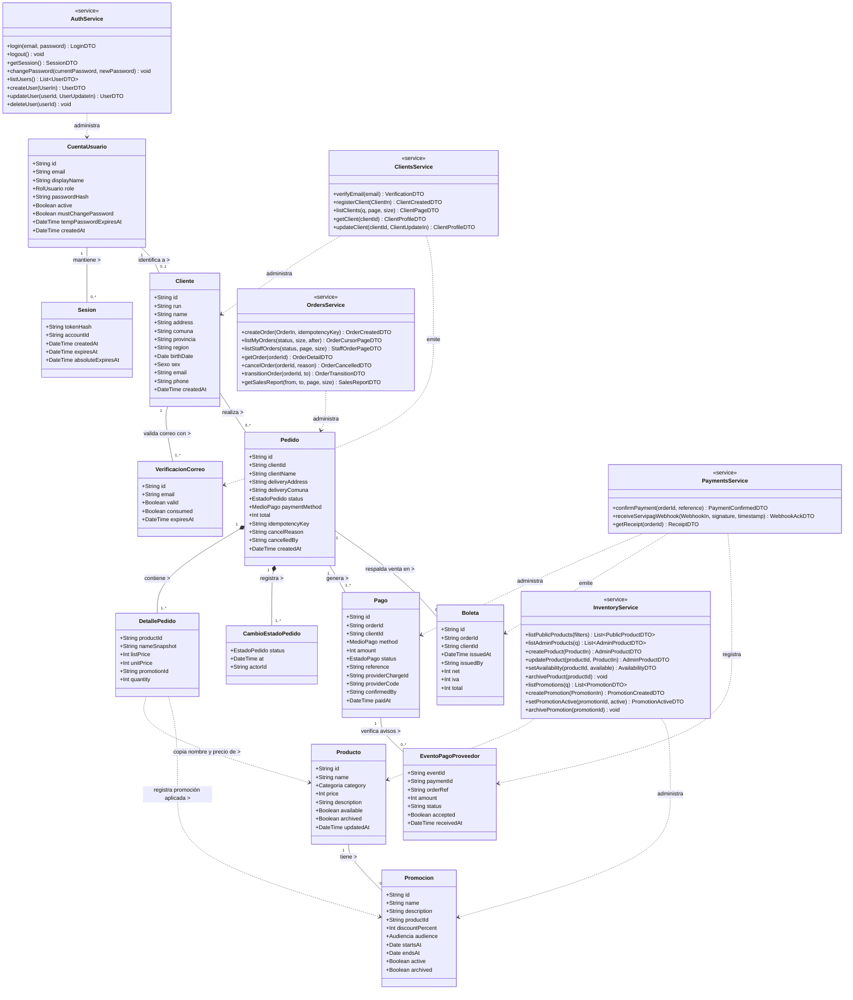
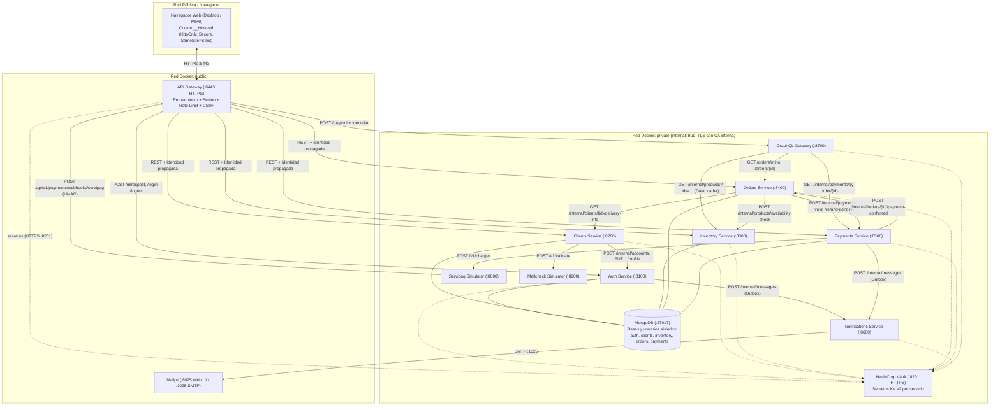
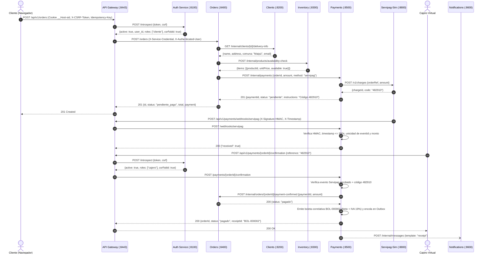
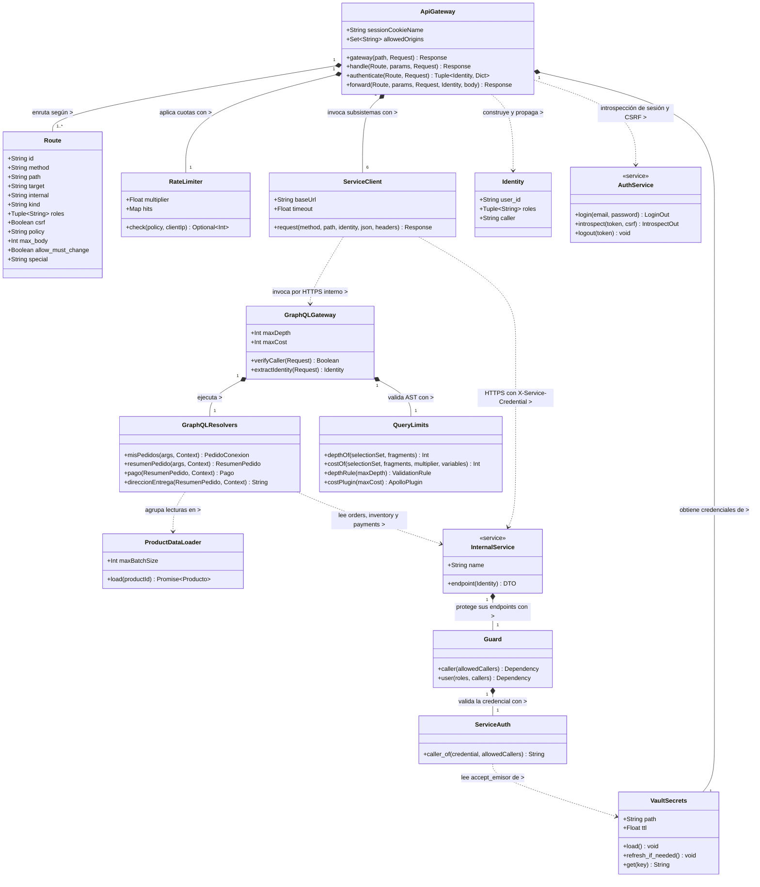

# La Chilena — Backend Seguro de Ventas On-Line y Despacho (Evaluación Unidad 2)

Backend seguro completo para **La Chilena**, empanadería artesanal chilena (empanadas de horno, empanadas fritas y bebidas tradicionales) con sede en Maipú. Implementa el **Caso 19** (*Sistema de Ventas On-line Fukusuke Sushi-Delivery*) con microservicios privados, API Gateway, Auth Service, HashiCorp Vault, GraphQL Gateway y persistencia en MongoDB.

**Alcance de esta entrega:** según la indicación del docente, la Evaluación 2 corresponde **solo al backend**. El frontend responsivo de la Unidad 1 se usa como **fuente de datos y requisitos**: sus pantallas y flujos definen los servicios del Módulo 1, y sus datos (`assets/js/data.js`) definen el modelo de dominio y los datos de prueba. El código del frontend no forma parte de esta entrega; su conexión con la API corresponde a la Evaluación 3. Todas las pruebas se ejecutan directamente contra el API Gateway, con un cliente HTTP que se comporta como el navegador (cookie de sesión, token CSRF y cabecera `Origin`).

## Portada e Identificación del Proyecto

- **Caso de negocio:** Caso 19 — Sistema de Ventas On-line y Delivery (adaptado a Empanadería Artesanal *La Chilena*, comuna de Maipú, radio de reparto gratuito de 3 km).
- **Integrantes:** Maximiliano Gallardo.
- **Frontend de referencia:** `la-chilena-MGallardo`, versión 1.0 de la Unidad 1 (12 pantallas HTML con datos simulados en `localStorage`), publicado en <https://maxigallardo3001-hub.github.io/PR-Desarrollo-WyM/la-chilena-MGallardo/la-chilena/index.html>. Se usa solo como fuente de pantallas, flujos y datos.
- **Stack tecnológico:**
  - **API Gateway y Microservicios Transaccionales:** Python 3.12 + FastAPI 0.162 + Uvicorn 0.54 sobre TLS interno (`gateway`, `auth`, `clients`, `inventory`, `orders`, `payments`, `notifications`, `servipag-sim`, `mailcheck-sim`).
  - **GraphQL Gateway Privado:** Node.js 22 LTS + Express 4.22 + Apollo Server 3 + DataLoader (`graphql`), las mismas bibliotecas GraphQL vistas en el curso.
  - **Persistencia y Gestión de Secretos:** MongoDB 7 (con usuarios y credenciales aislados por base de datos), HashiCorp Vault 1.17 (KV v2 con políticas de mínimo privilegio por servicio) y Mailpit (servidor SMTP/API local para recepción verificable de boletas y claves temporales).
  - **Pruebas:** scripts Python con `httpx` (humo, end-to-end, contratos y carga) ejecutados en un contenedor dentro de la red privada, y pruebas `node --test` del GraphQL Gateway.

## Resumen de Avances y Datos del Frontend Utilizados

El frontend de la Unidad 1 simulaba todas las operaciones en `localStorage`: guardaba usuarios con su contraseña en texto plano, calculaba precios y totales en el navegador y decidía por sí mismo el estado de cada pedido. Esta entrega construye el backend que reemplaza esa simulación por servicios reales, con persistencia, reglas de negocio, autenticación y autorización en el servidor.

### Datos del Frontend y su Correspondencia en el Backend

| Dato del frontend (`assets/js/data.js`) | Campos en el frontend | Sistema y colección en el backend | Cambios de diseño en el backend |
|---|---|---|---|
| `DEFAULT_PRODUCTS` (8 productos) | `id, cat, name, price, desc, stock` | `inventory` → `products` | Identificadores `p-0001`…`p-0008`, `stock` pasa a `available`, baja lógica `archived`, precio validado `> 0`. El precio de venta lo calcula el servidor (`finalPrice`). Se agregan las promociones (`promotions`) del Caso 19. |
| `DEFAULT_USERS` (4 cuentas del personal) | `id, email, pass, role, name` | `auth` → `accounts` | La contraseña deja de guardarse en texto: hash Argon2id. Las claves de demostración se leen desde Vault (`DEMO_PASSWORD_*`) y no quedan escritas en el código. Se agregan `active` y `mustChangePassword`. |
| `DEFAULT_CLIENTS` (cliente Constanza Rivas) | `run, name, email, pass, address, comuna, provincia, region, birth, sex, phone` | `clients` → `clients` (ficha) y `auth` → `accounts` (credencial) | Los datos personales quedan en `clients` y la credencial en `auth`. El RUN se valida con módulo 11. `birthDate` y `sex` se guardan pero ningún servicio los devuelve. |
| `DEFAULT_ORDERS` (`ORD-2026-0831` pendiente y `ORD-2026-0819` entregado) | `id, clientId, date, items[{id, name, price, qty}], pay, status` | `orders` → `orders` y `payments` → `payments`, `receipts` | Cada ítem guarda una copia del nombre y del precio al momento de comprar. El estado solo cambia por transiciones válidas en `orders`, y el pago solo lo confirma `payments`. El pedido entregado tiene su boleta. |
| Carrito (`lachilena_cart_<clientId>`) | `{productId: cantidad}` | Ninguno | Sigue siendo un borrador del navegador. Al confirmar, `orders` recibe solo `productId` y `quantity` e ignora precios o totales. |
| Sesión (`lachilena_session`) | Usuario completo en `localStorage` | `auth` → `sessions` | Sesión opaca con hash SHA-256, entregada en la cookie `__Host-sid` (`HttpOnly`), con expiración por inactividad y absoluta. |

Los estados de pedido (`pendiente_pago`, `pagado`, `en_preparacion`, `despachado`, `entregado`, `anulado`), los medios de pago (`servipag`, `deposito`) y los perfiles (`cliente`, `administrador`, `cajero`, `despacho`, `dueno`) se mantienen con los mismos nombres del frontend. Así, la conexión de la Evaluación 3 no requiere traducir valores.

### Servicios que Necesita Cada Pantalla del Frontend

| Pantalla (Unidad 1) | Operaciones que el backend implementa para ella |
|---|---|
| `P01 index.html` | Catálogo público con promociones vigentes y filtro de ofertas (`S10`), con precios distintos para visitantes y clientes autenticados. |
| `P02 login.html` | Ingreso (`S01`), sesión activa (`S03`), salida con revocación (`S02`) y cambio de contraseña obligatorio o voluntario (`S29`). |
| `P03 registro.html` | Verificación del correo con el servicio de mensajería (`S05`), validación del RUN y registro de cliente (`S04`). |
| `P04 carrito.html` | Precios vigentes del servidor (`S10`) y creación idempotente del pedido (`S15`), que responde con las instrucciones de pago o el código Servipag. |
| `P05 mis-pedidos.html` | Historial y detalle combinados por el **GraphQL Gateway** (`GQL`: `misPedidos` y `resumenPedido`), boleta (`S22`) y anulación con motivo (`S18`). |
| `P06 admin-productos.html` | Mantenedor de productos (`S11`–`S14`, `S30`) y de promociones (`S25`–`S28`) para administrador y dueño. |
| `P07 admin-clientes.html` | Listado y búsqueda de clientes (`S06`), registro asistido con clave temporal (`S04`, `S05`) y ficha del cliente (`S32`, `S33`). |
| `P08 admin-usuarios.html` | Listado, alta, edición y baja lógica del personal (`S07`–`S09`, `S31`) con clave temporal de 24 horas enviada por correo. |
| `P09 ventas.html` | Bandeja del cajero (`S19`), confirmación de pago por referencia o código Servipag (`S20`) y boleta emitida (`S22`). |
| `P10 despacho.html` | Cola de preparación y reparto por orden de llegada, con dirección de entrega (`S19`), y avance de estados (`S23`). |
| `P11 reportes.html` | Reporte de ventas por período calculado en el servidor (`S24`) y anulación administrativa (`S18`). |
| `P12 ayuda.html` | Página estática con el manual de uso; no necesita servicios. |

### Avances Verificados en Ejecución

1. **Datos de demostración listos para usar:** con `SEED_DEMO_DATA=true`, el backend carga los datos del frontend (catálogo de 8 productos, 5 cuentas y 2 pedidos con su cobro y boleta), además de 2 promociones y la cuenta bootstrap de administración del `.env`.
2. **Mantenedores completos:** el Caso 19 pide consultar, agregar y modificar productos, usuarios y clientes (`RF10`). El frontend no tenía las acciones de modificar, por eso el backend agrega `S30` (producto), `S31` (usuario), y `S32`/`S33` (ficha del cliente). Se registran como brecha de pantalla más abajo.
3. **Correcciones detectadas al ejecutar con Docker:** tráfico de Vault sin TLS, cobro que seguía vigente al anular un pedido pendiente, reactivación de promociones solapadas, numeración de pedidos con colisiones bajo carga y una CA interna sin la extensión *key usage*, que los clientes TLS estrictos (por ejemplo, Python 3.13 o superior) rechazan. `gen-certs.sh` ahora declara `CA:TRUE` y `keyCertSign` en la CA, y uso de servidor y cliente en cada certificado.

### Brechas Declaradas

| Brecha | Estado y propuesta |
|---|---|
| Conexión del frontend con la API | Fuera del alcance de esta entrega por indicación del docente; corresponde a la Evaluación 3. Propuesta: reemplazar las funciones de `data.js` y `auth.js` que usan `localStorage` por un cliente `fetch` hacia `/api/v1` (con `credentials: "include"` y el token CSRF en memoria) y servir las pantallas desde el mismo origen del gateway para conservar la cookie `SameSite=Strict`. |
| Pantallas para modificar datos (`S30`–`S33`) y paginación (`S19`) | El backend ya implementa y prueba estas operaciones. El frontend de la Unidad 1 no tiene botón de edición en los mantenedores ni una sección "Mis datos" para el cliente, y sus listados de caja y despacho no paginan. Se incorporarán en la Evaluación 3 como modales de edición en `P06`, `P07` y `P08`, un modal "Mis datos" en `P05` y controles de página en `P09` y `P10`. |
| Eliminación de la ficha de un cliente (derecho de supresión) | No implementada. Propuesta: `DELETE /api/v1/clients/{id}` solo para `administrador`, que retire la ficha de `clients`, desactive la cuenta en `auth` y anonimice la dirección en los pedidos históricos conservando montos y boletas. |
| Reembolso efectivo de pagos anulados | El sistema deja los cobros en `reembolso_pendiente`; la devolución del dinero se gestiona fuera del sistema (Servipag o transferencia), igual que en el caso de negocio. |
| Proveedores externos reales | Servipag y la validación de correo son adaptadores de prueba (`servipag-sim`, `mailcheck-sim`) que preservan contrato, autenticación HMAC/API key y transiciones; Mailpit reemplaza al servidor SMTP real. |
| Vault en modo desarrollo | Almacenamiento en memoria y token root en el log del contenedor (ver Módulo 6). En producción se usa almacenamiento persistente y el token root se revoca. |

## Inicio Rápido

Requisitos: Docker Desktop (en Windows, con WSL 2) y Python 3.10 o superior para generar el `.env`.

```bash
python infra/scripts/make_env.py
docker compose up -d --build --wait
```

La API queda disponible en `https://localhost:8443/api/v1` (el certificado es de una CA local de desarrollo). Comprobación rápida: `curl -k https://localhost:8443/api/v1/products` devuelve el catálogo. Los correos (claves temporales y boletas) llegan a Mailpit en `http://localhost:8025`. Para detener: `docker compose down`. El procedimiento completo, las pruebas, una demostración con `curl` y la solución de problemas están en el Módulo 10.

## Estructura del Proyecto y Guía del Código

```text
la-chilena-backend/
├── docker-compose.yml        Despliegue de los 13 servicios, redes public/private y volúmenes
├── requirements.txt          Dependencias Python versionadas (todas las imágenes de servicios)
├── common/lachilena_common/  Biblioteca compartida por los servicios Python
├── services/
│   ├── gateway/              API Gateway: rutas permitidas, sesión, CSRF y límites
│   ├── auth/                 Identidad, contraseñas, sesiones y cuentas del personal
│   ├── clients/              Padrón de clientes y verificación de correos
│   ├── inventory/            Catálogo, disponibilidad, promociones y precios finales
│   ├── orders/               Pedidos, transiciones, zonas de reparto y reporte de ventas
│   ├── payments/             Cobros, webhook de Servipag y boletas con IVA
│   ├── notifications/        Envío de correos por SMTP
│   ├── graphql/              GraphQL Gateway privado (Node.js + Apollo + DataLoader)
│   ├── servipag-sim/         Adaptador de prueba del proveedor de pagos
│   └── mailcheck-sim/        Adaptador de prueba del validador de correos
├── infra/
│   ├── certs/gen-certs.sh    CA interna y un certificado TLS por servicio
│   ├── vault/init.sh         Carga de secretos, políticas de solo lectura y tokens por servicio
│   ├── mongo/init-users.js   Un usuario de MongoDB por base de datos
│   └── scripts/              make_env.py (genera .env) y run-evidence.ps1 (ejecución completa)
├── docker/                   Dockerfiles: servicios Python, GraphQL y contenedor de pruebas
├── tests/                    Pruebas de humo, e2e, contratos, resiliencia y carga
└── evidencias/               Registros de la última ejecución y contratos capturados
```

### Biblioteca común (`common/lachilena_common`)

| Módulo | Responsabilidad |
|---|---|
| `app_factory.py` | `create_app()` crea la aplicación FastAPI de cada servicio: manejo de errores, `/health`, middleware que asigna o propaga `X-Correlation-Id` y registra cada solicitud. |
| `errors.py` | `ApiError` y el formato único de error `{"error": {"code", "message", "correlationId"}}`, también para errores de validación (`400 VALIDATION_ERROR` con `fields`). |
| `security.py` | `Identity`, `ServiceAuth` y `Guard`. `guard.caller("orders")` exige la credencial de servicio de un emisor concreto; `guard.user("cliente", ...)` exige además la identidad propagada por el gateway y uno de los roles indicados. |
| `vault.py` | `VaultSecrets`: lee por HTTPS la ruta `secret/data/<servicio>` con el token de solo lectura del contenedor, reintenta al arrancar y, si tiene TTL, refresca la copia local. |
| `http.py` | `ServiceClient`: cliente HTTPS entre servicios que agrega credencial, correlación e identidad, y traduce caídas y plazos vencidos a `503`/`504`. |
| `db.py` | Conexión a MongoDB con la URI que entrega Vault. |
| `outbox.py` | Bandeja de salida persistente: guarda mensajes en MongoDB y los reintenta en segundo plano (correos, avisos de reembolso o anulación de cobros). |
| `logging_setup.py` | Logs JSON con `correlationId` y `redact()`, que oculta campos con nombres sensibles (clave, token, RUN, correo, dirección, teléfono). |
| `run.py` / `healthcheck.py` | Arranque de Uvicorn con el certificado del servicio y verificación de salud usada por Docker. |

### Anatomía de un microservicio (`services/<servicio>/app/main.py`)

Todos los servicios Python siguen el mismo orden, así que leer uno sirve para leer los demás:

1. **Modelos de entrada** (`...In`, Pydantic): definen tipos, largos y patrones; los campos no declarados se ignoran, por eso el navegador no puede inyectar precios ni estados.
2. **Funciones de vista** (`..._view`, `admin_product`, `profile_view`): construyen los DTO de salida campo a campo; ningún endpoint devuelve el documento de MongoDB.
3. **`lifespan`**: carga los secretos desde Vault, abre la base de datos, crea índices, siembra los datos de demostración y crea los clientes HTTP hacia otros servicios.
4. **Dependencias de autorización** (`guard.caller(...)`, `guard.user(...)`): se declaran una vez y se aplican a cada endpoint con `Depends`.
5. **Endpoints públicos** (llamados por el gateway) y **endpoints `/internal/...`** (llamados solo por otro servicio identificado). Las reglas de negocio y la verificación de propiedad (`clientId == identity.user_id`) viven aquí, no en el gateway.

### Recorrido de una solicitud en el código

1. El cliente (en esta entrega, los scripts de `tests/`; en la Evaluación 3, el frontend) envía la solicitud a `/api/v1/...` con la cookie de sesión y `X-CSRF-Token` en los verbos que modifican.
2. `services/gateway/app/routes.py` busca la ruta en `ROUTES` (lista explícita de verbo, ruta, destino, roles y políticas); si no está, responde `404`.
3. `services/gateway/app/main.py` aplica el límite de solicitudes, el origen, la introspección de la sesión en `auth` (`authenticate`), el CSRF y los roles, y reenvía con `forward` agregando la credencial del destino y la identidad verificada. Las cabeceras de identidad que envía el navegador se descartan.
4. El servicio destino valida la credencial y la identidad con `Guard`, aplica sus reglas y responde con un DTO.
5. El gateway devuelve la respuesta tal cual (los `500` del destino se convierten en `502`).

### Cómo agregar un endpoint nuevo

1. Definir el modelo de entrada y la vista de salida en el `main.py` del servicio dueño del dato.
2. Crear el endpoint con la dependencia `guard.user(...)` o `guard.caller(...)` adecuada y verificar la propiedad del recurso.
3. Registrar la ruta en `services/gateway/app/routes.py` con su ID, roles y `csrf=True` si modifica datos.
4. Agregar el ejemplo del contrato en `tests/contracts.py`.
5. Agregar casos a `tests/e2e.py` (permitido, denegado y validación) y la fila correspondiente en las matrices de este informe.

### GraphQL Gateway (`services/graphql/src`)

| Archivo | Responsabilidad |
|---|---|
| `server.js` | Arranque HTTPS, verificación de la credencial del API Gateway, contexto por solicitud con identidad y `DataLoader`. |
| `schema.js` / `resolvers.js` | Tipos y resolvers; la autorización por campo está en los resolvers `pago` y `direccionEntrega`. |
| `limits.js` | Reglas sobre el AST: profundidad máxima y costo estimado según el tamaño de página. |
| `http.js` / `vault.js` | Cliente HTTPS hacia los subsistemas y lectura de secretos desde Vault. |

### Variables de configuración (`.env`)

`infra/scripts/make_env.py` genera el archivo con valores aleatorios; el repositorio no contiene ningún valor real. Solo `vault-init` (que carga Vault), `mongo` (que crea los usuarios) y el contenedor de pruebas leen el `.env`. Los servicios obtienen sus secretos desde Vault.

| Variable | Uso |
|---|---|
| `VAULT_DEV_ROOT_TOKEN` | Token root de Vault, usado solo por `vault-init`. |
| `MONGO_ROOT_USER`, `MONGO_ROOT_PASSWORD` | Administrador de MongoDB, usado solo al crear los usuarios por base. |
| `DB_PASS_AUTH`, `DB_PASS_CLIENTS`, `DB_PASS_INVENTORY`, `DB_PASS_ORDERS`, `DB_PASS_PAYMENTS` | Contraseña del usuario de cada base de datos. |
| `GW_*_SECRET`, `GQL_*_SECRET`, `ORDERS_*_SECRET`, `PAYMENTS_ORDERS_SECRET`, `CLIENTS_AUTH_SECRET`, `*_NOTIFY_SECRET` | Credenciales de servicio por par emisor-destino (Módulo 6). |
| `SERVIPAG_KEY`, `SERVIPAG_WEBHOOK_HMAC`, `MAILCHECK_KEY`, `SMTP_USER`, `SMTP_PASSWORD` | Credenciales de los proveedores (simulados). |
| `AUTH_CSRF_KEY` | Clave HMAC para derivar los tokens CSRF. |
| `SIM_CONTROL_KEY` | Permite a las pruebas pedir al simulador de Servipag que envíe un aviso de pago. |
| `BOOTSTRAP_ADMIN_EMAIL`, `BOOTSTRAP_ADMIN_PASSWORD` | Administrador inicial, con cambio de clave obligatorio. |
| `DEMO_PASSWORD_ADMIN`, `DEMO_PASSWORD_CAJERO`, `DEMO_PASSWORD_DESPACHO`, `DEMO_PASSWORD_DUENO`, `DEMO_PASSWORD_CLIENTE` | Contraseñas de las cuentas de demostración. `vault-init` las carga en `secret/auth` y `auth` las usa solo al sembrar datos (`SEED_DEMO_DATA=true`); ninguna contraseña está escrita en el código. |
| `RATE_LIMIT_MULTIPLIER` (opcional) | Multiplica los límites del gateway; `1` por defecto y `200` para `e2e.py` y `loadtest.py`. |
| `DELIVERY_COMUNAS` (opcional) | Comunas con reparto al crear la base por primera vez (por defecto `Maipú,Santiago`). |

### Puertos publicados

| Servicio | Dirección | Notas |
|---|---|---|
| API Gateway | `https://localhost:8443/api/v1` | Único punto de entrada de la aplicación; cualquier otra ruta responde `404`. |
| Mailpit (interfaz web) | `http://localhost:8025` | Solo en `127.0.0.1`; para revisar correos de prueba. |
| Resto de servicios, Vault y MongoDB | Sin puerto publicado | Solo accesibles dentro de la red `private`. |

## Requisitos del Caso 19 vs. Decisiones de Arquitectura

| Código | Requisito del Caso 19 | Decisión de Arquitectura adoptada |
|---|---|---|
| **RF1** | Armar pedido con productos disponibles en el menú | El borrador del carrito vive en el navegador solo como pares `{productId, quantity}`; al confirmar (`S15`), `orders` consulta a `inventory` disponibilidad y precios vigentes e ignora cualquier monto enviado por el cliente. |
| **RF2** | Preparar la orden solo una vez confirmado el pago | `orders` crea el pedido en `pendiente_pago`; únicamente `payments` (tras la confirmación del cajero en `S20`) está autorizado a invocar `/internal/orders/{id}/payment-confirmed` para pasarlo a `pagado` y habilitarlo en `despacho.html`. |
| **RF3** | Anulación de compra indicando motivo (Cliente y Admin) | `POST /api/v1/orders/{id}/cancellation` (`S18`) conserva el registro para auditoría y reportes, registra `cancelReason`, `cancelledBy` y `cancelledAt`, y avisa a `payments`: si estaba pendiente de pago anula el cobro (el código Servipag deja de servir y un aviso tardío queda como reembolso pendiente); si estaba pagado marca el reembolso pendiente. Si `payments` no responde, el aviso queda en el Outbox de `orders` y se reintenta. |
| **RF4** | Ventas web asociadas a clientes registrados y cajero virtual | Solo el rol `cliente` puede crear pedidos (`S15`) y solo el rol `cajero` puede confirmar pagos (`S20`), registrando su identidad en `confirmedBy` y `issuedBy`. |
| **RF5** | Registro de clientes (RUN, nombre, dirección, comuna, provincia, región, fecha nac., sexo, correo, teléfono) y acceso a promociones | `clients` valida el RUN con módulo 11 y custodia los datos personales; `inventory` evalúa si la solicitud proviene de un cliente autenticado para aplicar descuentos con audiencia `registrados`. |
| **RF6** | Registro por el propio cliente en web o asistido por el administrador | `POST /api/v1/clients` (`S04`) soporta registro anónimo (con contraseña elegida por el cliente) y registro con sesión de `administrador` (donde `auth` genera una clave temporal de 24 h y la envía por correo). |
| **RF7** | Administrar disponibilidad y catálogo de productos | `inventory` expone `S11`–`S14` y `S25`–`S28` para `administrador` y `dueno`, aplicando baja lógica (`archived: true`) para no romper referencias históricas en pedidos anteriores. |
| **RF8** | Emitir boleta digital por cada venta y enviarla por correo | Al confirmar el pago (`S20`), `payments` genera una boleta correlativa (`BOL-xxxxxx`) con desglose de Neto e IVA (19%) y la encola en su `Outbox` hacia `notifications` (SMTP Mailpit). |
| **RF9** | Reporte de ventas por período para dueño y administrador | `orders` calcula mediante agregaciones indexadas en MongoDB (`S24`) los KPIs y el ranking por producto sobre los estados efectivos de venta (`pagado`, `en_preparacion`, `despachado`, `entregado`), sin exponer RUN ni direcciones. |
| **RF10** | Mantenedores de productos, usuarios y clientes | Separados según autoridad de dominio: productos/promociones en `inventory` (`S11`–`S14`, `S30`), clientes en `clients` (`S04`, `S06`, `S32`, `S33`) y cuentas de personal en `auth` (`S07`–`S09`, `S31`). Cada mantenedor permite consultar, agregar y modificar; la eliminación es lógica (archivado o baja) para conservar el historial. |
| **RF11** | Validar existencia real del correo electrónico mediante API | `clients` invoca a `mailcheck-sim` (`POST /v1/validate`) y emite un `verificationId` con vigencia de 15 minutos y de un solo uso, exigido al crear el cliente (`S04`). |
| **RF12** | Autenticación y control de acceso por perfil | Sesiones opacas en `auth` con hash SHA-256 del token, cookie `HttpOnly` en el navegador, introspección en el API Gateway y verificación de rol y propiedad en cada microservicio. |
| **RF13** | Imprimir órdenes de despacho en orden de llegada | `GET /api/v1/orders` (`S19`) para el rol `despacho` ordena por `createdAt` ascendente; la pantalla `despacho.html` del frontend ya imprime la lista con `@media print`. |

## Módulo 1 — Servicios Derivados del Frontend

### Matriz de Servicios y Trazabilidad

| ID | Requisito / CU | Pantalla y acción | Propósito | Verbo y ruta externa | Entrada (resumen) | Salida (resumen) | Reglas y errores principales | Clasificación de datos | Acceso |
|---|---|---|---|---|---|---|---|---|---|
| **S01** | RF12 / CU1 | `P02 login.html` → Ingresar | Autenticar usuario e iniciar sesión | `POST /api/v1/auth/login` | Body: `{email, password}` | `200` `{user, mustChangePassword, csrfToken, expiresIn}` + Cookie `__Host-sid` | `400` formato inválido; `401` credenciales incorrectas; `429` bloqueo tras 5 fallos o límite IP | Credencial / Restringido | Anónimo |
| **S02** | RF12 / CU1 | Barra superior → Salir | Revocar sesión activa y borrar cookie | `POST /api/v1/auth/logout` | Cookie `__Host-sid` + Header `X-CSRF-Token` | `204` sin contenido + expiración de cookie | `401` sin sesión; `403` CSRF inválido | Credencial | Autenticado (todos) |
| **S03** | RF12 / CU1 | Todas las pantallas → Cargar sesión | Recuperar usuario activo y token CSRF | `GET /api/v1/auth/session` | Cookie `__Host-sid` | `200` `{user, mustChangePassword, csrfToken, expiresAt}` | `401` sesión inexistente o expirada (limpia cookie) | Restringido | Autenticado (todos) |
| **S04** | RF5, RF6, RF10 / CU3 | `P03 registro.html` y `P07 admin-clientes.html` → Crear cuenta | Registrar nuevo cliente (propio o asistido) | `POST /api/v1/clients` | Body: `{run, name, address, comuna, provincia, region, birthDate, sex, email, phone, password?, verificationId}` | `201` `{id, name, email}` | `400` RUN o fecha inválidos; `409` RUN/correo duplicado; `422` correo no verificado | Personal / Sensible / Credencial | Anónimo o `administrador` |
| **S05** | RF5, RF6, RF11 / CU3 | `P03 registro.html` y `P07` → Validar correo | Comprobar existencia del correo vía API | `POST /api/v1/clients/email-verifications` | Body: `{email}` | `200` `{verificationId, valid}` | `400` correo mal formado; `502` validador externo no disponible | Personal | Anónimo o `administrador` |
| **S06** | RF10 / CU3 | `P07 admin-clientes.html` → Listar/buscar | Consultar padrón de clientes | `GET /api/v1/clients?q=&page=&size=` | Query opcional: `q`, `page`, `size` | `200` `{items: [{id, run, name, email, comuna, phone}], page, size, total}` | `403` rol distinto de administrador; omite `birthDate` y `sex` | Personal | Autenticado (`administrador`) |
| **S07** | RF10, RF12 / CU2 | `P08 admin-usuarios.html` → Listar personal | Consultar cuentas de colaboradores | `GET /api/v1/users` | Sin cuerpo | `200` `[{id, name, email, role, active}]` | `403` rol sin permiso; nunca expone `passwordHash` | Restringido | Autenticado (`administrador`) |
| **S08** | RF10, RF12 / CU2 | `P08 admin-usuarios.html` → Nuevo usuario | Crear cuenta de personal con clave temporal | `POST /api/v1/users` | Body: `{name, email, role}` + CSRF | `201` `{id, name, email, role, active}` | `400` rol inválido; `409` correo duplicado; envía clave temporal por correo | Restringido | Autenticado (`administrador`) |
| **S09** | RF10, RF12 / CU2 | `P08 admin-usuarios.html` → Dar de baja | Desactivar cuenta de personal y sus sesiones | `DELETE /api/v1/users/{userId}` | Path: `userId` + CSRF | `204` sin contenido | `404` no existe; `409` intento de baja propia o del último admin activo | Restringido | Autenticado (`administrador`) |
| **S10** | RF1, RF5, RF7 / CU5 | `P01 index.html` y `P04 carrito.html` → Ver menú | Consultar catálogo y promociones aplicables | `GET /api/v1/products?category=&available=&onOffer=` | Query opcional: `category`, `available`, `onOffer` | `200` `{items: [{id, name, category, price, finalPrice, promotion, description, available}]}` | `400` filtro inválido; aplica ofertas `registrados` solo si hay sesión de `cliente` | Público | Anónimo o Autenticado |
| **S11** | RF7, RF10 / CU4 | `P06 admin-productos.html` → Listar catálogo | Consultar productos para administración | `GET /api/v1/admin/products?q=` | Query opcional: `q` | `200` `{items: [{id, name, category, price, description, available, updatedAt}]}` | `403` rol no autorizado | Público / Interno | Autenticado (`administrador`, `dueno`) |
| **S12** | RF7, RF10 / CU4 | `P06 admin-productos.html` → Agregar producto | Incorporar nuevo producto al menú | `POST /api/v1/admin/products` | Body: `{name, category, price, description}` + CSRF | `201` `{id, name, category, price, description, available, updatedAt}` | `400` precio `<= 0`; `409` nombre duplicado | Público / Interno | Autenticado (`administrador`, `dueno`) |
| **S13** | RF7 / CU4 | `P06 admin-productos.html` → Switch disponible | Actualizar disponibilidad de un producto | `PUT /api/v1/admin/products/{productId}/availability` | Path: `productId`; Body: `{available}` + CSRF | `200` `{id, available}` | `404` producto no encontrado | Público / Interno | Autenticado (`administrador`, `dueno`) |
| **S14** | RF7, RF10 / CU4 | `P06 admin-productos.html` → Eliminar producto | Archivar producto y sus promociones | `DELETE /api/v1/admin/products/{productId}` | Path: `productId` + CSRF | `204` sin contenido | `404` producto no encontrado; conserva historial en pedidos previos | Interno | Autenticado (`administrador`, `dueno`) |
| **S15** | RF1, RF4 / CU5 | `P04 carrito.html` → Confirmar pedido | Crear pedido validando zona, stock y precios | `POST /api/v1/orders` | Header `Idempotency-Key` + CSRF; Body: `{items: [{productId, quantity}], paymentMethod}` | `201` `{id, status, items, total, payment, createdAt}` (`200` si repite llave) | `400` sin `Idempotency-Key`; `409` producto agotado; `422` comuna fuera de zona de reparto | Personal / Restringido | Autenticado (`cliente`) |
| **S16** | RF1, RF3 / CU5, CU7 | Respaldo REST de `P05 mis-pedidos.html` | Listar pedidos del cliente autenticado | `GET /api/v1/orders/mine?status=&size=&after=&include=` | Query opcional: `status`, `size`, `after`, `include` | `200` `{items, nextCursor}` | Filtra estrictamente por `clientId == identity.user_id` | Restringido | Autenticado (`cliente`) |
| **S17** | RF1, RF13 / CU5, CU9 | Detalle individual de pedido | Consultar estado, ítems e historial de un pedido | `GET /api/v1/orders/{orderId}` | Path: `orderId` | `200` `{id, status, items, total, paymentMethod, createdAt, history, deliveryAddress?}` | `403` si el pedido es de otro cliente o fuera del ámbito del rol; `404` no existe | Personal / Restringido | Autenticado (`cliente`, `cajero`, `despacho`, `administrador`) |
| **S18** | RF3 / CU7 | `P05 mis-pedidos.html` y `P11 reportes.html` → Anular | Anular pedido registrando motivo y actor | `POST /api/v1/orders/{orderId}/cancellation` | Path: `orderId`; Body: `{reason}` + CSRF | `200` `{id, status: "anulado", cancelledAt, cancelledBy}` | `403` pedido ajeno; `409` estado no anulable (`entregado` o en preparación para cliente) | Restringido | Autenticado (`cliente`, `administrador`) |
| **S19** | RF2, RF4, RF13 / CU6, CU9 | `P09 ventas.html` y `P10 despacho.html` → Listar | Listar cola operativa para caja o despacho | `GET /api/v1/orders?status=&page=&size=` | Query opcional: `status`, `page`, `size` | `200` `{items, page, size, total}` (`deliveryAddress` solo para `despacho`) | `403` si `cajero` pide estados distintos de `pendiente_pago` | Personal / Restringido | Autenticado (`cajero`, `despacho`) |
| **S20** | RF2, RF4, RF8 / CU6 | `P09 ventas.html` → Confirmar pago | Confirmar pago, pasar pedido a `pagado` y emitir boleta | `POST /api/v1/payments/{orderId}/confirmation` | Path: `orderId`; Body: `{reference}` + CSRF | `200` `{orderId, status: "pagado", paidAt, receiptId}` | `409` referencia duplicada o pedido anulado; `422` código Servipag sin webhook aprobado | Restringido | Autenticado (`cajero`) |
| **S21** | RF2, RF4 / CU6 | Integración externa Servipag → Webhook | Registrar notificación firmada del proveedor de pago | `POST /api/v1/payments/webhooks/servipag` | Headers `X-Signature`, `X-Timestamp`; Body: `{eventId, orderRef, amount, status}` | `200` `{"received": true}` | `401` firma HMAC inválida o timestamp > 300 s; `409` monto distinto al cobro | Secreto / Interno | Proveedor externo (HMAC) |
| **S22** | RF8 / CU6 | `P05 mis-pedidos.html` y `P09 ventas.html` → Ver boleta | Consultar boleta electrónica emitida | `GET /api/v1/orders/{orderId}/receipt` | Path: `orderId` | `200` `{receiptId, orderId, issuedAt, items, net, iva, total}` | `403` cliente ajeno; `409` pedido aún sin boleta | Restringido | Autenticado (`cliente`, `cajero`, `administrador`) |
| **S23** | RF2, RF13 / CU9 | `P10 despacho.html` → Avanzar estado | Avanzar pedido a preparación, despacho o entrega | `POST /api/v1/orders/{orderId}/transitions` | Path: `orderId`; Body: `{to}` + CSRF | `200` `{id, status, updatedAt}` | `409` transición inválida (ej. saltar de `pagado` a `entregado`) | Restringido | Autenticado (`despacho`) |
| **S24** | RF9 / CU8 | `P11 reportes.html` → Consultar período | Obtener KPIs y ventas agregadas por rango de fechas | `GET /api/v1/reports/sales?from=&to=&page=&size=` | Query: `from`, `to`, `page`, `size` | `200` `{period, kpis, byProduct, orders, page, size, total}` | `400` rango inválido o mayor a 366 días; `403` rol no autorizado | Restringido | Autenticado (`administrador`, `dueno`) |
| **S25** | RF5, RF7 / CU4 | `P06 admin-productos.html` → Listar promociones | Consultar promociones creadas | `GET /api/v1/admin/promotions?q=` | Query opcional: `q` | `200` `{items: [{id, name, productId, productName, discountPercent, audience, startsAt, endsAt, active}]}` | `403` rol no autorizado | Público / Interno | Autenticado (`administrador`, `dueno`) |
| **S26** | RF5, RF7 / CU4 | `P06 admin-productos.html` → Nueva promoción | Crear descuento por producto, vigencia y audiencia | `POST /api/v1/admin/promotions` | Body: `{name, description, productId, discountPercent, audience, startsAt, endsAt}` + CSRF | `201` `{id, active: true}` | `400` fechas inválidas; `404` producto inexistente; `409` solapamiento de promoción activa | Público / Interno | Autenticado (`administrador`, `dueno`) |
| **S27** | RF5, RF7 / CU4 | `P06 admin-productos.html` → Activar/desactivar | Cambiar estado activo de una promoción | `PUT /api/v1/admin/promotions/{promotionId}/active` | Path: `promotionId`; Body: `{active}` + CSRF | `200` `{id, active}` | `404` promoción no encontrada | Interno | Autenticado (`administrador`, `dueno`) |
| **S28** | RF5, RF7 / CU4 | `P06 admin-productos.html` → Eliminar promoción | Archivar promoción | `DELETE /api/v1/admin/promotions/{promotionId}` | Path: `promotionId` + CSRF | `204` sin contenido | `404` promoción no encontrada | Interno | Autenticado (`administrador`, `dueno`) |
| **S29** | RF12 / CU1 | Modal de cambio de clave → Guardar | Actualizar contraseña propia e invalidar otras sesiones | `POST /api/v1/auth/password` | Body: `{currentPassword, newPassword}` + CSRF | `204` sin contenido | `400` clave actual errónea o nueva `< 8` caracteres; `429` tras 5 fallos | Credencial | Autenticado (todos) |
| **S30** | RF7, RF10 / CU4 | `P06 admin-productos.html` → Editar producto (acción por agregar, ver brechas) | Modificar nombre, categoría, precio y descripción | `PUT /api/v1/admin/products/{productId}` | Path: `productId`; Body: `{name, category, price, description}` + CSRF | `200` `{id, name, category, price, description, available, updatedAt}` | `400` precio `<= 0`; `404` no existe o archivado; `409` nombre usado por otro producto. Los pedidos previos conservan su snapshot de precio | Público / Interno | Autenticado (`administrador`, `dueno`) |
| **S31** | RF10, RF12 / CU2 | `P08 admin-usuarios.html` → Editar usuario (acción por agregar, ver brechas) | Cambiar nombre, perfil asignado o reactivar/desactivar una cuenta de personal | `PUT /api/v1/users/{userId}` | Path: `userId`; Body: `{name, role, active}` + CSRF | `200` `{id, name, email, role, active}` | `404` no existe o es cliente; `409` quitarse el propio perfil o dejar sin administrador activo; si cambia el rol o se desactiva, revoca sus sesiones | Restringido | Autenticado (`administrador`) |
| **S32** | RF5, RF10 / CU3 | `P05 mis-pedidos.html` → Mis datos y `P07 admin-clientes.html` → Editar (acciones por agregar, ver brechas) | Consultar la ficha de contacto y entrega de un cliente | `GET /api/v1/clients/{clientId}` | Path: `clientId` | `200` `{id, run, name, email, address, comuna, provincia, region, phone}` | `403` si un `cliente` pide una ficha que no es la suya; `404` no existe; nunca devuelve `birthDate` ni `sex` | Personal / Restringido | Autenticado (`cliente` propio, `administrador`) |
| **S33** | RF5, RF10 / CU3 | `P05 mis-pedidos.html` → Mis datos y `P07 admin-clientes.html` → Editar (acciones por agregar, ver brechas) | Actualizar nombre, dirección, comuna, provincia, región y teléfono | `PUT /api/v1/clients/{clientId}` | Path: `clientId`; Body: `{name, address, comuna, provincia, region, phone}` + CSRF | `200` ficha actualizada | `400` teléfono o campos inválidos; `403` ficha ajena; RUN y correo son inmutables (se ignoran); los pedidos ya creados conservan su dirección | Personal / Restringido | Autenticado (`cliente` propio, `administrador`) |
| **GQL** | Módulo 8 / RF1, RF3, RF8 | `P05 mis-pedidos.html` → Listado y detalle | Consultar `misPedidos` y `resumenPedido` agregando `orders`, `inventory` y `payments` | `POST /api/v1/graphql` | Body: `{operationName, query, variables}` + CSRF | `200` `{data, errors?}` | `400` sin `operationName`, profundidad > 5 o costo > 200; `413` > 4 KB | Personal / Restringido | Autenticado (según resolver y campo) |

### Ejemplos JSON de Contratos Principales

#### `S15` — Crear pedido (`POST /api/v1/orders`)
```json
// Solicitud (Cabeceras: Cookie: __Host-sid=..., X-CSRF-Token: ..., Idempotency-Key: 9f8a7b6c5d4e3f2a)
{
  "items": [
    { "productId": "p-0001", "quantity": 2 },
    { "productId": "p-0007", "quantity": 1 }
  ],
  "paymentMethod": "servipag"
}

// Respuesta 201 Created (los precios y el total los calcula el servidor)
{
  "id": "ORD-2026-1026-0042",
  "status": "pendiente_pago",
  "items": [
    { "productId": "p-0001", "name": "Empanada de pino", "unitPrice": 2500, "quantity": 2 },
    { "productId": "p-0007", "name": "Mote con huesillo", "unitPrice": 1800, "quantity": 1 }
  ],
  "total": 6800,
  "payment": {
    "method": "servipag",
    "status": "pendiente",
    "instructions": "Paga en Servipag con el código 482910"
  },
  "createdAt": "2026-10-26T22:15:10.120Z"
}
```

#### `S20` — Confirmar pago y emitir boleta (`POST /api/v1/payments/ORD-2026-1026-0042/confirmation`)
```json
// Solicitud (Rol: cajero)
{
  "reference": "482910"
}

// Respuesta 200 OK
{
  "orderId": "ORD-2026-1026-0042",
  "status": "pagado",
  "paidAt": "2026-10-26T22:18:45.000Z",
  "receiptId": "BOL-000002"
}
```

#### `S22` — Consultar boleta electrónica (`GET /api/v1/orders/ORD-2026-1026-0042/receipt`)
```json
{
  "receiptId": "BOL-000002",
  "orderId": "ORD-2026-1026-0042",
  "issuedAt": "2026-10-26T22:18:45.000Z",
  "items": [
    { "name": "Empanada de pino", "quantity": 2, "unitPrice": 2500 },
    { "name": "Mote con huesillo", "quantity": 1, "unitPrice": 1800 }
  ],
  "net": 5714,
  "iva": 1086,
  "total": 6800
}
```

### Ejemplos JSON de todos los contratos (capturados del sistema en ejecución)

Los siguientes pares solicitud/respuesta se obtuvieron ejecutando `tests/contracts.py` contra el sistema levantado con Docker Compose (archivo completo en `evidencias/contratos.json`). Todos los datos son ficticios; las listas se recortan a dos elementos y los tokens largos se abrevian. La cookie `__Host-sid` y la cabecera `X-CSRF-Token` acompañan a toda solicitud autenticada y no se repiten en cada ejemplo.

<details><summary><code>S01</code> · <code>POST /api/v1/auth/login</code> → <code>200</code></summary>

Solicitud:
```json
{
  "email": "ana.perez-d5e6cd@example.cl",
  "password": "Cliente#2026ok"
}
```

Respuesta:
```json
{
  "user": {
    "id": "3a9020e2-fe0d-4231-86c5-4f5e339f1133",
    "name": "Ana Pérez Soto",
    "role": "cliente"
  },
  "mustChangePassword": false,
  "csrfToken": "70aa08b52555…",
  "expiresIn": 900
}
```

</details>

<details><summary><code>S02</code> · <code>POST /api/v1/auth/logout</code> → <code>204</code></summary>

Respuesta: sin cuerpo.

</details>

<details><summary><code>S03</code> · <code>GET /api/v1/auth/session</code> → <code>200</code></summary>

Respuesta:
```json
{
  "user": {
    "id": "3a9020e2-fe0d-4231-86c5-4f5e339f1133",
    "name": "Ana Pérez Soto",
    "role": "cliente"
  },
  "mustChangePassword": false,
  "csrfToken": "70aa08b52555…",
  "expiresAt": "2026-11-05T23:10:17Z"
}
```

</details>

<details><summary><code>S04</code> · <code>POST /api/v1/clients</code> → <code>201</code></summary>

Solicitud:
```json
{
  "run": "12.786.259-1",
  "name": "Ana Pérez Soto",
  "address": "Av. Pajaritos 1200",
  "comuna": "Maipú",
  "provincia": "Santiago",
  "region": "Metropolitana",
  "birthDate": "1994-03-21",
  "sex": "F",
  "email": "ana.perez-d5e6cd@example.cl",
  "phone": "+56987654321",
  "password": "Cliente#2026ok",
  "verificationId": "v-51c6f9774c2a4ee9"
}
```

Respuesta:
```json
{
  "id": "3a9020e2-fe0d-4231-86c5-4f5e339f1133",
  "name": "Ana Pérez Soto",
  "email": "ana.perez-d5e6cd@example.cl"
}
```

</details>

<details><summary><code>S05</code> · <code>POST /api/v1/clients/email-verifications</code> → <code>200</code></summary>

Solicitud:
```json
{
  "email": "ana.perez-d5e6cd@example.cl"
}
```

Respuesta:
```json
{
  "verificationId": "v-51c6f9774c2a4ee9",
  "valid": true
}
```

</details>

<details><summary><code>S06</code> · <code>GET /api/v1/clients?q=ana.perez&size=2</code> → <code>200</code></summary>

Respuesta:
```json
{
  "items": [
    {
      "id": "3a9020e2-fe0d-4231-86c5-4f5e339f1133",
      "run": "12.786.259-1",
      "name": "Ana Pérez Soto",
      "email": "ana.perez-d5e6cd@example.cl",
      "comuna": "Maipú",
      "phone": "+56987654321"
    }
  ],
  "page": 1,
  "size": 2,
  "total": 1
}
```

</details>

<details><summary><code>S07</code> · <code>GET /api/v1/users</code> → <code>200</code></summary>

Respuesta:
```json
[
  {
    "id": "17ce83b6-6c9d-434f-a21c-8f533c8d5066",
    "name": "Admin Prueba",
    "email": "admin-2e7be688@example.cl",
    "role": "administrador",
    "active": false
  },
  {
    "id": "97a3a031-09da-4cc0-97be-fea8885af952",
    "name": "Administrador",
    "email": "admin@lachilena.local",
    "role": "administrador",
    "active": true
  }
]
```

</details>

<details><summary><code>S08</code> · <code>POST /api/v1/users</code> → <code>201</code></summary>

Solicitud:
```json
{
  "name": "Rosa Tapia",
  "email": "rosa-f9483a@lachilena.cl",
  "role": "despacho"
}
```

Respuesta:
```json
{
  "id": "b3cb81d9-03d2-476f-a8dc-1eebfb760125",
  "name": "Rosa Tapia",
  "email": "rosa-f9483a@lachilena.cl",
  "role": "despacho",
  "active": true
}
```

</details>

<details><summary><code>S09</code> · <code>DELETE /api/v1/users/b3cb81d9-03d2-476f-a8dc-1eebfb760125</code> → <code>204</code></summary>

Respuesta: sin cuerpo.

</details>

<details><summary><code>S10</code> · <code>GET /api/v1/products?category=horno</code> → <code>200</code></summary>

Respuesta:
```json
{
  "items": [
    {
      "id": "p-0001",
      "name": "Empanada de pino",
      "category": "horno",
      "price": 2500,
      "finalPrice": 2500,
      "promotion": null,
      "description": "Carne molida, cebolla, huevo duro, aceituna y pasas. La clásica chilena.",
      "available": true
    },
    {
      "id": "p-0002",
      "name": "Empanada de queso",
      "category": "horno",
      "price": 2200,
      "finalPrice": 1870,
      "promotion": {
        "id": "pr-0002",
        "name": "15% en empanadas de queso",
        "discountPercent": 15
      },
      "description": "Queso gauda derretido, horneada hasta dorar.",
      "available": true
    }
  ]
}
```

</details>

<details><summary><code>S11</code> · <code>GET /api/v1/admin/products?q=pino</code> → <code>200</code></summary>

Respuesta:
```json
{
  "items": [
    {
      "id": "p-0001",
      "name": "Empanada de pino",
      "category": "horno",
      "price": 2500,
      "description": "Carne molida, cebolla, huevo duro, aceituna y pasas. La clásica chilena.",
      "available": true,
      "updatedAt": "2026-11-05T22:52:07Z"
    }
  ]
}
```

</details>

<details><summary><code>S12</code> · <code>POST /api/v1/admin/products</code> → <code>201</code></summary>

Solicitud:
```json
{
  "name": "Empanada de pollo 5588",
  "category": "horno",
  "price": 2600,
  "description": "Pollo, pimentón y cebolla."
}
```

Respuesta:
```json
{
  "id": "p-281c97ea8a",
  "name": "Empanada de pollo 5588",
  "category": "horno",
  "price": 2600,
  "description": "Pollo, pimentón y cebolla.",
  "available": true,
  "updatedAt": "2026-11-05T22:55:29Z"
}
```

</details>

<details><summary><code>S13</code> · <code>PUT /api/v1/admin/products/p-281c97ea8a/availability</code> → <code>200</code></summary>

Solicitud:
```json
{
  "available": false
}
```

Respuesta:
```json
{
  "id": "p-281c97ea8a",
  "available": false
}
```

</details>

<details><summary><code>S14</code> · <code>DELETE /api/v1/admin/products/p-281c97ea8a</code> → <code>204</code></summary>

Respuesta: sin cuerpo.

</details>

<details><summary><code>S15</code> · <code>POST /api/v1/orders</code> → <code>201</code></summary>

Cabeceras adicionales: `Idempotency-Key: 83fc65e3c89441a78ba583016be7fd81`

Solicitud:
```json
{
  "items": [
    {
      "productId": "p-0001",
      "quantity": 2
    },
    {
      "productId": "p-0004",
      "quantity": 1
    }
  ],
  "paymentMethod": "deposito"
}
```

Respuesta:
```json
{
  "id": "ORD-2026-1105-0008",
  "status": "pendiente_pago",
  "items": [
    {
      "productId": "p-0001",
      "name": "Empanada de pino",
      "unitPrice": 2500,
      "quantity": 2
    },
    {
      "productId": "p-0004",
      "name": "Empanada de carne",
      "unitPrice": 3150,
      "quantity": 1
    }
  ],
  "total": 8150,
  "payment": {
    "method": "deposito",
    "status": "pendiente",
    "instructions": "Realiza el depósito de $8.150 y presenta el comprobante al cajero"
  },
  "createdAt": "2026-11-05T22:55:17.320Z"
}
```

</details>

<details><summary><code>S16</code> · <code>GET /api/v1/orders/mine?size=2</code> → <code>200</code></summary>

Respuesta:
```json
{
  "items": [
    {
      "id": "ORD-2026-1105-0008",
      "createdAt": "2026-11-05T22:55:17.320Z",
      "status": "pendiente_pago",
      "itemsCount": 3,
      "total": 8150,
      "summary": "Empanada de pino x2, Empanada de carne x1",
      "canCancel": true
    }
  ],
  "nextCursor": null
}
```

</details>

<details><summary><code>S17</code> · <code>GET /api/v1/orders/ORD-2026-1105-0008</code> → <code>200</code></summary>

Respuesta:
```json
{
  "id": "ORD-2026-1105-0008",
  "status": "pendiente_pago",
  "items": [
    {
      "productId": "p-0001",
      "name": "Empanada de pino",
      "unitPrice": 2500,
      "quantity": 2
    },
    {
      "productId": "p-0004",
      "name": "Empanada de carne",
      "unitPrice": 3150,
      "quantity": 1
    }
  ],
  "total": 8150,
  "paymentMethod": "deposito",
  "createdAt": "2026-11-05T22:55:17.320Z",
  "history": [
    {
      "status": "pendiente_pago",
      "at": "2026-11-05T22:55:17.320Z"
    }
  ],
  "deliveryAddress": "Av. 5 de Abril 450, Maipú"
}
```

</details>

<details><summary><code>S18</code> · <code>POST /api/v1/orders/ORD-2026-1105-0009/cancellation</code> → <code>200</code></summary>

Solicitud:
```json
{
  "reason": "Solicitud del cliente"
}
```

Respuesta:
```json
{
  "id": "ORD-2026-1105-0009",
  "status": "anulado",
  "cancelledAt": "2026-11-05T22:55:29.212Z",
  "cancelledBy": "cliente"
}
```

</details>

<details><summary><code>S19</code> · <code>GET /api/v1/orders?status=pendiente_pago&size=2</code> → <code>200</code></summary>

Respuesta:
```json
{
  "items": [
    {
      "id": "ORD-2026-0831",
      "createdAt": "2026-08-31T20:47:00.000Z",
      "status": "pendiente_pago",
      "total": 6800,
      "paymentMethod": "deposito",
      "clientName": "Constanza Rivas",
      "items": [
        {
          "name": "Empanada de pino",
          "quantity": 2
        },
        {
          "name": "Mote con huesillo",
          "quantity": 1
        }
      ]
    },
    {
      "id": "ORD-2026-1105-0002",
      "createdAt": "2026-11-05T22:54:50.387Z",
      "status": "pendiente_pago",
      "total": 2500,
      "paymentMethod": "deposito",
      "clientName": "Cliente de Prueba",
      "items": [
        {
          "name": "Empanada de pino",
          "quantity": 1
        }
      ]
    }
  ],
  "page": 1,
  "size": 2,
  "total": 4
}
```

</details>

<details><summary><code>S20</code> · <code>POST /api/v1/payments/ORD-2026-1105-0008/confirmation</code> → <code>200</code></summary>

Solicitud:
```json
{
  "reference": "DEP-2026-09E771"
}
```

Respuesta:
```json
{
  "orderId": "ORD-2026-1105-0008",
  "status": "pagado",
  "paidAt": "2026-11-05T22:55:29.027Z",
  "receiptId": "BOL-000005"
}
```

</details>

<details><summary><code>S21</code> · <code>POST /api/v1/payments/webhooks/servipag</code> → <code>200</code></summary>

Cabeceras adicionales: `X-Signature: <HMAC-SHA256 hex>`, `X-Timestamp: <epoch s>`

Solicitud:
```json
{
  "eventId": "evt-662c75849566",
  "orderRef": "ORD-2026-1105-0009",
  "amount": 5610,
  "status": "approved"
}
```

Respuesta:
```json
{
  "received": true
}
```

</details>

<details><summary><code>S22</code> · <code>GET /api/v1/orders/ORD-2026-1105-0008/receipt</code> → <code>200</code></summary>

Respuesta:
```json
{
  "receiptId": "BOL-000005",
  "orderId": "ORD-2026-1105-0008",
  "issuedAt": "2026-11-05T22:55:29.045Z",
  "items": [
    {
      "name": "Empanada de pino",
      "quantity": 2,
      "unitPrice": 2500
    },
    {
      "name": "Empanada de carne",
      "quantity": 1,
      "unitPrice": 3150
    }
  ],
  "net": 6849,
  "iva": 1301,
  "total": 8150
}
```

</details>

<details><summary><code>S23</code> · <code>POST /api/v1/orders/ORD-2026-1105-0008/transitions</code> → <code>200</code></summary>

Solicitud:
```json
{
  "to": "en_preparacion"
}
```

Respuesta:
```json
{
  "id": "ORD-2026-1105-0008",
  "status": "en_preparacion",
  "updatedAt": "2026-11-05T22:55:29.083Z"
}
```

</details>

<details><summary><code>S24</code> · <code>GET /api/v1/reports/sales?from=2026-11-05&to=2026-11-05&size=2</code> → <code>200</code></summary>

Respuesta:
```json
{
  "period": {
    "from": "2026-11-05",
    "to": "2026-11-05"
  },
  "kpis": {
    "orders": 3,
    "revenue": 21250,
    "averageTicket": 7083,
    "cancelled": 4
  },
  "byProduct": [
    {
      "productId": "p-0001",
      "name": "Empanada de pino",
      "units": 4,
      "revenue": 10000
    },
    {
      "productId": "p-0004",
      "name": "Empanada de carne",
      "units": 3,
      "revenue": 9450
    }
  ],
  "orders": [
    {
      "id": "ORD-2026-1105-0009",
      "createdAt": "2026-11-05T22:55:29.149Z",
      "clientName": "Ana Pérez Soto",
      "status": "anulado",
      "total": 5610
    },
    {
      "id": "ORD-2026-1105-0008",
      "createdAt": "2026-11-05T22:55:17.320Z",
      "clientName": "Ana Pérez Soto",
      "status": "en_preparacion",
      "total": 8150
    }
  ],
  "page": 1,
  "size": 2,
  "total": 9
}
```

</details>

<details><summary><code>S25</code> · <code>GET /api/v1/admin/promotions?q=pollo</code> → <code>200</code></summary>

Respuesta:
```json
{
  "items": [
    {
      "id": "pr-ce26c8dc56",
      "name": "Martes de pollo",
      "description": "Descuento para clientes registrados.",
      "productId": "p-281c97ea8a",
      "productName": "Empanada de pollo 5588",
      "discountPercent": 20,
      "audience": "registrados",
      "startsAt": "2026-11-05",
      "endsAt": "2026-11-12",
      "active": true
    }
  ]
}
```

</details>

<details><summary><code>S26</code> · <code>POST /api/v1/admin/promotions</code> → <code>201</code></summary>

Solicitud:
```json
{
  "name": "Martes de pollo",
  "description": "Descuento para clientes registrados.",
  "productId": "p-281c97ea8a",
  "discountPercent": 20,
  "audience": "registrados",
  "startsAt": "2026-11-05",
  "endsAt": "2026-11-12"
}
```

Respuesta:
```json
{
  "id": "pr-ce26c8dc56",
  "active": true
}
```

</details>

<details><summary><code>S27</code> · <code>PUT /api/v1/admin/promotions/pr-ce26c8dc56/active</code> → <code>200</code></summary>

Solicitud:
```json
{
  "active": false
}
```

Respuesta:
```json
{
  "id": "pr-ce26c8dc56",
  "active": false
}
```

</details>

<details><summary><code>S28</code> · <code>DELETE /api/v1/admin/promotions/pr-ce26c8dc56</code> → <code>204</code></summary>

Respuesta: sin cuerpo.

</details>

<details><summary><code>S29</code> · <code>POST /api/v1/auth/password</code> → <code>204</code></summary>

Solicitud:
```json
{
  "currentPassword": "Cliente#2026ok",
  "newPassword": "NuevaClave#2026"
}
```

Respuesta: sin cuerpo.

</details>

<details><summary><code>S30</code> · <code>PUT /api/v1/admin/products/p-281c97ea8a</code> → <code>200</code></summary>

Solicitud:
```json
{
  "name": "Empanada de pollo 5588",
  "category": "horno",
  "price": 2700,
  "description": "Pollo, pimentón, cebolla y aceituna."
}
```

Respuesta:
```json
{
  "id": "p-281c97ea8a",
  "name": "Empanada de pollo 5588",
  "category": "horno",
  "price": 2700,
  "description": "Pollo, pimentón, cebolla y aceituna.",
  "available": true,
  "updatedAt": "2026-11-05T22:55:29Z"
}
```

</details>

<details><summary><code>S31</code> · <code>PUT /api/v1/users/b3cb81d9-03d2-476f-a8dc-1eebfb760125</code> → <code>200</code></summary>

Solicitud:
```json
{
  "name": "Rosa Tapia",
  "role": "cajero",
  "active": true
}
```

Respuesta:
```json
{
  "id": "b3cb81d9-03d2-476f-a8dc-1eebfb760125",
  "name": "Rosa Tapia",
  "email": "rosa-f9483a@lachilena.cl",
  "role": "cajero",
  "active": true
}
```

</details>

<details><summary><code>S32</code> · <code>GET /api/v1/clients/3a9020e2-fe0d-4231-86c5-4f5e339f1133</code> → <code>200</code></summary>

Respuesta:
```json
{
  "id": "3a9020e2-fe0d-4231-86c5-4f5e339f1133",
  "run": "12.786.259-1",
  "name": "Ana Pérez Soto",
  "email": "ana.perez-d5e6cd@example.cl",
  "address": "Av. Pajaritos 1200",
  "comuna": "Maipú",
  "provincia": "Santiago",
  "region": "Metropolitana",
  "phone": "+56987654321"
}
```

</details>

<details><summary><code>S33</code> · <code>PUT /api/v1/clients/3a9020e2-fe0d-4231-86c5-4f5e339f1133</code> → <code>200</code></summary>

Solicitud:
```json
{
  "name": "Ana Pérez Soto",
  "address": "Av. 5 de Abril 450",
  "comuna": "Maipú",
  "provincia": "Santiago",
  "region": "Metropolitana",
  "phone": "+56987654321"
}
```

Respuesta:
```json
{
  "id": "3a9020e2-fe0d-4231-86c5-4f5e339f1133",
  "run": "12.786.259-1",
  "name": "Ana Pérez Soto",
  "email": "ana.perez-d5e6cd@example.cl",
  "address": "Av. 5 de Abril 450",
  "comuna": "Maipú",
  "provincia": "Santiago",
  "region": "Metropolitana",
  "phone": "+56987654321"
}
```

</details>

<details><summary><code>GQL</code> · <code>POST /api/v1/graphql</code> → <code>200</code></summary>

Solicitud:
```json
{
  "operationName": "Resumen",
  "query": "query Resumen($id: ID!) { resumenPedido(orderId: $id) { pedido { id estado total items { nombre cantidad precioUnitario producto { descripcion disponible } } } medioPago pago { estado boletaDisponible } historial { estado en } direccionEntrega } }",
  "variables": {
    "id": "ORD-2026-1105-0008"
  }
}
```

Respuesta:
```json
{
  "data": {
    "resumenPedido": {
      "pedido": {
        "id": "ORD-2026-1105-0008",
        "estado": "PENDIENTE_PAGO",
        "total": 8150,
        "items": [
          {
            "nombre": "Empanada de pino",
            "cantidad": 2,
            "precioUnitario": 2500,
            "producto": {
              "descripcion": "Carne molida, cebolla, huevo duro, aceituna y pasas. La clásica chilena.",
              "disponible": true
            }
          },
          {
            "nombre": "Empanada de carne",
            "cantidad": 1,
            "precioUnitario": 3150,
            "producto": {
              "descripcion": "Rellena con carne molida, cebolla y ajo, frita al momento.",
              "disponible": true
            }
          }
        ]
      },
      "medioPago": "DEPOSITO",
      "pago": {
        "estado": "PENDIENTE",
        "boletaDisponible": false
      },
      "historial": [
        {
          "estado": "PENDIENTE_PAGO",
          "en": "2026-11-05T22:55:17.320Z"
        }
      ],
      "direccionEntrega": "Av. 5 de Abril 450, Maipú"
    }
  }
}
```

</details>

## Módulo 2 — Clases y Cardinalidades del Dominio

### Diagrama UML de Clases del Dominio y Servicios Públicos



### Justificación de Relaciones, Multiplicidades y Decisiones de Dominio

| Clase Origen | Clase Destino | Multiplicidad | Regla de Negocio que la origina |
|---|---|---|---|
| `CuentaUsuario` | `Sesion` | `1` a `0..*` | Un usuario puede no tener sesiones activas o haber iniciado sesión en más de un dispositivo; al cambiar la contraseña (`S29`) o dar de baja la cuenta (`S09`), se revocan sus sesiones. |
| `CuentaUsuario` | `Cliente` | `1` a `0..1` | Toda cuenta con rol `cliente` tiene exactamente un perfil en `clients` con el mismo UUID; las cuentas de personal (`administrador`, `cajero`, `despacho`, `dueno`) no tienen registro en `clients`. |
| `Producto` | `Promocion` | `1` a `0..*` | Un producto puede tener cero o varias promociones a lo largo del tiempo, pero la regla de negocio en `S26` impide que dos promociones activas del mismo producto se solapen en fechas. |
| `Cliente` | `Pedido` | `1` a `0..*` | Solo los clientes registrados pueden emitir pedidos (`RF4`), y un cliente recién registrado aún tiene cero pedidos. |
| `Pedido` | `DetallePedido` | `1` a `1..*` (Composición) | Un pedido confirmado debe contener entre 1 y 30 líneas de producto (`quantity` entre 1 y 50 por producto). Los detalles no existen fuera de su pedido. |
| `Pedido` | `Pago` | `1` a `1..*` | Al crearse un pedido (`S15`) se inicia de inmediato su cobro en `payments`; si un pedido no logra registrar su cobro inicial, se revierte antes de responder al cliente. |
| `Pedido` | `Boleta` | `1` a `0..1` | Un pedido en `pendiente_pago` o `anulado` antes de pagar no tiene boleta (`0`); una vez confirmado el pago por el cajero (`S20`), se emite una única boleta electrónica (`1`) asociada a ese `orderId`. |
| `Cliente` | `VerificacionCorreo` | `1` a `1..*` | Para registrar un cliente (`S04`) se exige al menos una verificación de correo válida, vigente (15 min) y de un solo uso; si vence o el correo cambia, se crea otra. Las verificaciones no usadas expiran por índice TTL. |
| `Pedido` | `CambioEstadoPedido` | `1` a `1..*` (Composición) | Todo pedido nace con su primer registro (`pendiente_pago`) y cada transición, pago o anulación agrega uno con fecha y actor; el historial se guarda dentro del pedido y no existe sin él. |
| `Pago` | `EventoPagoProveedor` | `1` a `0..*` | Un cobro por depósito no recibe avisos; uno de Servipag puede recibir varios (aprobado, rechazado o reenvíos). `eventId` es la clave primaria, de modo que un aviso repetido no se procesa dos veces. |
| `DetallePedido` | `Producto` y `Promocion` | Dependencia (`..>`), sin multiplicidad | El detalle copia nombre y precios del producto al comprar (`nameSnapshot`, `listPrice`, `unitPrice`) y guarda el `promotionId` aplicado. No es una asociación viva: archivar o cambiar el precio de un producto, o desactivar la promoción (`S14`, `S30`, `S27`), no altera pedidos ni boletas anteriores. |

- **¿El carrito y el pedido son clases distintas?** Sí. El carrito es un borrador efímero en el navegador (pares `{productId, quantity}`), mientras que el `Pedido` es una entidad transaccional persistida en `orders` únicamente cuando el cliente confirma la compra (`S15`), momento en que el servidor valida zona de reparto, disponibilidad y precios oficiales.
- **¿Qué ocurre con el historial si un producto deja de estar disponible o se elimina?** La eliminación de productos (`S14`) es un archivado lógico (`archived: true`), y cada `DetallePedido` conserva instantáneas inmutables (`nameSnapshot`, `listPrice`, `unitPrice`, `promotionId`) tomadas al momento de la compra. Así, las boletas y los reportes históricos jamás se alteran aunque el producto cambie de precio o salga del menú.
- **Separación entre modelo interno y DTOs:** Ningún servicio devuelve documentos crudos de MongoDB. Por ejemplo, `CuentaUsuario` almacena `passwordHash` y `tempPasswordExpiresAt`, pero `UserOut` solo expone `{id, name, email, role, active}`; `Cliente` almacena `birthDate`, `sex` y `address`, pero `S06` (`GET /clients`) solo proyecta `{id, run, name, email, comuna, phone}` y `S24` (`GET /reports/sales`) omite tanto el RUN como la dirección.

### Leyenda de Notación UML

| Símbolo (Mermaid) | Significado en los diagramas de este informe |
|---|---|
| `A "1" -- "0..*" B` | Asociación entre registros de negocio, con la multiplicidad escrita en ambos extremos. |
| `A "1" *-- "1..*" B` | Composición: las partes (`B`) no existen sin el todo (`A`) y se persisten dentro de su documento. |
| `A ..> B` | Dependencia: `A` usa el contrato o la clase `B`; no implica una relación entre registros. |
| `<<service>>` | Interfaz pública de un microservicio; cada operación corresponde a un ID del Módulo 1. |
| `+atributo Tipo` | Atributo del modelo interno persistido; no implica que salga en una respuesta (ver DTOs). |
| `List~T~` | Colección de elementos de tipo `T`. |
| `1`, `0..1`, `0..*`, `1..*` | Exactamente uno, cero o uno, cero o más, uno o más. |

### Correspondencia entre Operaciones UML e IDs de Servicio

| Clase `<<service>>` | Operación UML | ID | Verbo y ruta externa |
|---|---|---|---|
| `AuthService` | `login(email, password)` | `S01` | `POST /api/v1/auth/login` |
| `AuthService` | `logout()` | `S02` | `POST /api/v1/auth/logout` |
| `AuthService` | `getSession()` | `S03` | `GET /api/v1/auth/session` |
| `AuthService` | `changePassword(currentPassword, newPassword)` | `S29` | `POST /api/v1/auth/password` |
| `AuthService` | `listUsers()` | `S07` | `GET /api/v1/users` |
| `AuthService` | `createUser(UserIn)` | `S08` | `POST /api/v1/users` |
| `AuthService` | `updateUser(userId, UserUpdateIn)` | `S31` | `PUT /api/v1/users/{userId}` |
| `AuthService` | `deleteUser(userId)` | `S09` | `DELETE /api/v1/users/{userId}` |
| `ClientsService` | `registerClient(ClientIn)` | `S04` | `POST /api/v1/clients` |
| `ClientsService` | `verifyEmail(email)` | `S05` | `POST /api/v1/clients/email-verifications` |
| `ClientsService` | `listClients(q, page, size)` | `S06` | `GET /api/v1/clients` |
| `ClientsService` | `getClient(clientId)` | `S32` | `GET /api/v1/clients/{clientId}` |
| `ClientsService` | `updateClient(clientId, ClientUpdateIn)` | `S33` | `PUT /api/v1/clients/{clientId}` |
| `InventoryService` | `listPublicProducts(filters)` | `S10` | `GET /api/v1/products` |
| `InventoryService` | `listAdminProducts(q)` | `S11` | `GET /api/v1/admin/products` |
| `InventoryService` | `createProduct(ProductIn)` | `S12` | `POST /api/v1/admin/products` |
| `InventoryService` | `setAvailability(productId, available)` | `S13` | `PUT /api/v1/admin/products/{productId}/availability` |
| `InventoryService` | `archiveProduct(productId)` | `S14` | `DELETE /api/v1/admin/products/{productId}` |
| `InventoryService` | `updateProduct(productId, ProductIn)` | `S30` | `PUT /api/v1/admin/products/{productId}` |
| `InventoryService` | `listPromotions(q)` | `S25` | `GET /api/v1/admin/promotions` |
| `InventoryService` | `createPromotion(PromotionIn)` | `S26` | `POST /api/v1/admin/promotions` |
| `InventoryService` | `setPromotionActive(promotionId, active)` | `S27` | `PUT /api/v1/admin/promotions/{promotionId}/active` |
| `InventoryService` | `archivePromotion(promotionId)` | `S28` | `DELETE /api/v1/admin/promotions/{promotionId}` |
| `OrdersService` | `createOrder(OrderIn, idempotencyKey)` | `S15` | `POST /api/v1/orders` |
| `OrdersService` | `listMyOrders(status, size, after)` | `S16` | `GET /api/v1/orders/mine` |
| `OrdersService` | `getOrder(orderId)` | `S17` | `GET /api/v1/orders/{orderId}` |
| `OrdersService` | `cancelOrder(orderId, reason)` | `S18` | `POST /api/v1/orders/{orderId}/cancellation` |
| `OrdersService` | `listStaffOrders(status, page, size)` | `S19` | `GET /api/v1/orders` |
| `OrdersService` | `transitionOrder(orderId, to)` | `S23` | `POST /api/v1/orders/{orderId}/transitions` |
| `OrdersService` | `getSalesReport(from, to, page, size)` | `S24` | `GET /api/v1/reports/sales` |
| `PaymentsService` | `confirmPayment(orderId, reference)` | `S20` | `POST /api/v1/payments/{orderId}/confirmation` |
| `PaymentsService` | `receiveServipagWebhook(WebhookIn, signature, timestamp)` | `S21` | `POST /api/v1/payments/webhooks/servipag` |
| `PaymentsService` | `getReceipt(orderId)` | `S22` | `GET /api/v1/orders/{orderId}/receipt` |
| `GraphQLGateway` | `misPedidos(...)`, `resumenPedido(orderId)` | `GQL` | `POST /api/v1/graphql` |

## Módulo 3 — Sistemas e Integraciones

### Matriz de Subsistemas y Autoridad de Datos

| Sistema | Naturaleza | Responsabilidad y autoridad de estado | Datos bajo su custodia (MongoDB / Memoria) | Servicios públicos asociados | Dependencias internas / externas | Credencial requerida (`X-Service-Credential`) | Respuesta y resiliencia ante fallos |
|---|---|---|---|---|---|---|---|
| **`gateway`** | Frontera pública (API Gateway) | Enrutamiento por lista blanca, validación de sesión con `auth`, control de roles, CSRF, cabeceras de seguridad y límites de tasa por IP. | Sin base de datos (caché en memoria de secretos de Vault con TTL 300 s y ventanas de rate limit). | `S01` a `S33`, `GQL` | `auth`, `clients`, `inventory`, `orders`, `payments`, `graphql`, `vault` | Emite credencial específica por destino (`<target>_credential`). | Si `auth` o `vault` fallan devuelve `503`; si un microservicio de negocio no responde o tarda > 5 s devuelve `502 BAD_GATEWAY` o `504 UPSTREAM_TIMEOUT`. |
| **`auth`** | Microservicio privado de seguridad | Autoridad de identidad, credenciales (Argon2id), sesiones opacas, tokens CSRF y cuentas del personal. | Base `auth`: colecciones `accounts`, `sessions`, `login_failures`, `outbox`. | `S01`, `S02`, `S03`, `S07`, `S08`, `S09`, `S29`, `S31` | `notifications` (vía `Outbox` persistente) | Acepta `accept_api-gateway` y `accept_clients` (solo en `/internal/accounts*`). | Si `notifications` cae al crear un usuario (`S08`), la clave temporal queda en la colección `outbox` de `auth` y se reintenta cada 10 s sin abortar la creación. |
| **`clients`** | Microservicio privado de negocio | Autoridad de los datos personales del padrón de clientes y de la verificación previa de correos. | Base `clients`: colecciones `clients`, `email_verifications`. | `S04`, `S05`, `S06`, `S32`, `S33` | `auth` (`/internal/accounts`, `/internal/accounts/{id}/profile`), `mailcheck-sim` (`/v1/validate`) | Acepta `accept_api-gateway` y `accept_orders` (en `/internal/clients/{id}/delivery-info`). | En `S04`, si falla la inserción en `clients` después de crear la cuenta en `auth`, ejecuta compensación Saga (`DELETE /internal/accounts/{id}`). |
| **`inventory`** | Microservicio privado de negocio | Autoridad exclusiva del catálogo, disponibilidad de productos, promociones vigentes y cálculo de precios finales. | Base `inventory`: colecciones `products`, `promotions` (con caché de lectura de 30 s invalidada en cada escritura). | `S10` a `S14`, `S25` a `S28`, `S30` | Sin dependencias hacia otros microservicios | Acepta `accept_api-gateway`, `accept_orders` y `accept_graphql-gateway`. | Si un producto está agotado al cotizar (`availability-check`), informa la lista exacta a `orders` para rechazar el pedido con `409 PRODUCTS_UNAVAILABLE`. |
| **`orders`** | Microservicio privado de negocio | Autoridad del ciclo de vida del pedido (`pendiente_pago` → `pagado` → `en_preparacion` → `despachado` → `entregado` / `anulado`), zonas de reparto y reportes de ventas. | Base `orders`: colecciones `orders`, `delivery_zones`, `outbox`. | `S15` a `S19`, `S23`, `S24` | `clients`, `inventory`, `payments` | Acepta `accept_api-gateway`, `accept_graphql-gateway` (solo en las lecturas `GET /orders/mine` y `GET /orders/{id}`; crear, anular, despachar y reportar exigen al API Gateway) y `accept_payments` (solo para pasar a `pagado`). | En `S15`, si `payments` no puede iniciar el cobro, `orders` elimina el pedido recién insertado. Al anular (`S18`) llama a `payments` (`/void` si estaba pendiente, `/refund-pending` si estaba pagado) y, si no responde, encola el aviso en su `outbox`. |
| **`payments`** | Microservicio privado de negocio | Autoridad de los cobros, verificación de referencias/webhooks de Servipag, numeración correlativa y emisión de boletas electrónicas. | Base `payments`: colecciones `payments`, `payment_events`, `receipts`, `counters`, `outbox`. | `S20`, `S21`, `S22` | `orders`, `notifications` (vía `Outbox`), `servipag-sim` | Acepta `accept_api-gateway`, `accept_orders` y `accept_graphql-gateway`. | Si `orders` no responde cuando el cajero confirma un pago (`S20`), `payments` guarda `syncPending: true`, responde `503 PAYMENT_RECORDED_SYNC_PENDING` y su `reconcile_loop` lo sincroniza automáticamente. |
| **`graphql`** | Gateway privado de agregación | Composición de lecturas entre `orders`, `inventory` y `payments` para la vista de cliente y seguimiento de pedidos. | Sin base de datos ni estado persistente (`DataLoader` por solicitud). | `GQL` (`POST /api/v1/graphql`) | `orders`, `inventory`, `payments` | Acepta solo `accept_api-gateway` y exige identidad verificada. | Si `inventory` falla durante `misPedidos`, degrada con error parcial en el subcampo `producto` conservando la lista de pedidos de `orders`. |
| **`notifications`** | Microservicio privado de soporte | Renderizado y envío SMTP de correos transaccionales (claves temporales y boletas electrónicas). | Sin base de datos (delega cola en los emisores). | Ninguno (solo `/internal/messages`) | `mailpit` (SMTP :1025) | Acepta solo `accept_auth` y `accept_payments`, los dos únicos emisores de correos. | Si el servidor SMTP falla devuelve `502 DELIVERY_FAILED` para que el `Outbox` del servicio emisor reintente. |
| **`servipag-sim` / `mailcheck-sim`** | Adaptadores de proveedores externos | Simulación determinista y firmada de los contratos de Servipag (`/v1/charges` + webhook HMAC) y validación de correo (`/v1/validate`). | En memoria para pruebas reproducibles. | Ninguno directo | `gateway` (solo webhook saliente desde `servipag-sim`) | `accept_payments` / `accept_clients` | Permiten probar caídas, firmas HMAC alteradas, timestamps vencidos y correos rebotados sin depender de cuentas externas pagadas. |

La columna de respuesta ante fallos no es solo de diseño: `tests/resilience.py` detiene `inventory`, `payments` y `auth` con el sistema en ejecución y comprueba cada respuesta (casos `R17`–`R25`, Módulo 10).

### Mapa de Componentes y Red de Contenedores



### Diagrama de Secuencia — Creación de Pedido, Webhook Servipag y Confirmación de Caja



## Módulo 4 — Stakeholders y Permisos HTTP

### Registro de Stakeholders e Identidades

| Stakeholder / Actor | Categoría | Interés en el sistema | Rol o identidad técnica asociada | Uso de información y forma de acceso |
|---|---|---|---|---|
| **Visitante web** | Usuario externo | Explorar la carta de empanadas, precios y ofertas públicas antes de registrarse. | `anonymous` | Consulta `S10`, `S05` y `S04` a través del API Gateway. |
| **Cliente registrado** | Usuario externo | Comprar en línea con despacho gratuito en su zona, acceder a descuentos exclusivos, seguir sus pedidos, descargar su boleta o anular compras. | Rol `cliente` | Invoca `S01`–`S03`, `S10`, `S15`–`S18`, `S22`, `S29`, `S32`, `S33` y `GQL` únicamente sobre sus propios recursos (`clientId == user_id`). |
| **Cajero virtual** | Personal interno | Verificar pagos de pedidos web (depósito o Servipag), confirmar la venta y emitir la boleta electrónica. | Rol `cajero` | Invoca `S19` (solo `status=pendiente_pago`), `S17`, `S20`, `S22` y `S29`. No ve direcciones de entrega ni administra catálogo. |
| **Encargado de despacho** | Personal interno | Visualizar e imprimir órdenes pagadas por orden de llegada y coordinar su paso por cocina y reparto hasta la entrega. | Rol `despacho` | Invoca `S19` (estados `pagado`, `en_preparacion`, `despachado`), `S17`, `S23` y `S29`. Recibe `deliveryAddress`, pero no accede a datos de pago ni reportes financieros. |
| **Administrador** | Personal interno | Administrar catálogo, promociones, cuentas de personal, padrón de clientes, reportes y anulaciones operativas. | Rol `administrador` | Invoca `S04`–`S09`, `S11`–`S14`, `S17`, `S18`, `S22`, `S24`–`S33`. |
| **Dueño del local** | Dirección / Supervisión | Supervisar el rendimiento comercial mediante reportes de ventas y gestionar la oferta de productos y promociones. | Rol `dueno` | Invoca `S11`–`S14`, `S24`–`S30`. No interviene en la operación individual de caja ni despacho. |
| **Cocineros y Repartidores** | Personal operativo | Preparar los pedidos en el orden correcto y entregarlos en el domicilio dentro del radio de 3 km. | **Sin permisos operativos** | No invocan APIs; reciben las órdenes de despacho impresas o proyectadas por el Encargado de Despacho desde `despacho.html` (`CU9` / `RF13`). |
| **Servicio de Impuestos Internos / Contabilidad** | Entidad externa | Respaldo tributario de las boletas emitidas y cuadratura de IVA (19%). | **Sin permisos operativos** | Reciben la información mediante las boletas correlativas (`BOL-xxxxxx`) y los cierres exportados desde el reporte de ventas (`S24`). |
| **Proveedor de pagos (Servipag)** | Sistema externo | Notificar de manera asíncrona la aprobación o rechazo de un cobro en línea. | Identidad técnica `webhook` (HMAC-SHA256) | Solo puede invocar `POST /api/v1/payments/webhooks/servipag` (`S21`) presentando firma `X-Signature` y `X-Timestamp` vigentes. |
| **Microservicios internos** | Identidades de servicio | Colaborar dentro de la red privada sin intervención del navegador. | `api-gateway`, `graphql-gateway`, `orders`, `payments`, `clients`, `auth` | Autenticados punto a punto mediante `X-Service-Credential` verificada contra Vault en cada servicio destino. |

### Matriz de Permisos HTTP por Servicio y Recurso

| Rol / Identidad | Servicio y Ruta Externa | GET | POST | PUT | DELETE | Alcance, condición de negocio y componente que verifica |
|---|---|---|---|---|---|---|
| **Visitante (`anonymous`)** | `S10` `/api/v1/products` | Permitido | Denegado (405) | Denegado (405) | Denegado (405) | Devuelve solo campos públicos y promociones con `audience="todos"`. Verifica `gateway` e `inventory`. |
| **Visitante (`anonymous`)** | `S05` `/api/v1/clients/email-verifications`<br/>`S04` `/api/v1/clients` | Denegado (405) | Permitido | Denegado (405) | Denegado (405) | Registro público exige `password` y `verificationId` vigente; limitado a 10 req/min por IP en `gateway`. |
| **Cliente (`cliente`)** | `S15` `/api/v1/orders`<br/>`S16` `/api/v1/orders/mine` | Permitido (`S16`) | Permitido (`S15`) | Denegado (405) | Denegado (405) | `S15` exige `Idempotency-Key`, CSRF y comuna habilitada; `S16` filtra por `clientId == identity.user_id` en `orders`. |
| **Cliente (`cliente`)** | `S17` `/api/v1/orders/{orderId}`<br/>`S22` `/api/v1/orders/{orderId}/receipt` | Permitido (propio) | Denegado (405) | Denegado (405) | Denegado (405) | Permitido **solo si** `order.clientId == identity.user_id`; si pertenece a otro cliente, `orders` / `payments` responden `403 FORBIDDEN`. |
| **Cliente (`cliente`)** | `S18` `/api/v1/orders/{orderId}/cancellation` | Denegado (405) | Permitido (propio) | Denegado (405) | Denegado (405) | Solo si el pedido le pertenece y su estado es `pendiente_pago` o `pagado`; nunca borra el registro (conserva historial). |
| **Cliente (`cliente`)** | `S32` / `S33` `/api/v1/clients/{clientId}` | Permitido (propio) | Denegado (405) | Permitido (propio) | Denegado (405) | Solo si `clientId == identity.user_id`; otro id responde `403`. RUN y correo no se modifican. Verifica `gateway` (rol) y `clients` (propiedad). |
| **Cliente (`cliente`)** | `GQL` `/api/v1/graphql` | Denegado (405) | Permitido | Denegado (405) | Denegado (405) | Autorizado para `misPedidos` (propios) y `resumenPedido` (solo si es dueño del pedido). Verifica `graphql` y `orders`. |
| **Cajero (`cajero`)** | `S19` `/api/v1/orders`<br/>`S20` `/api/v1/payments/{orderId}/confirmation` | Permitido (`S19`) | Permitido (`S20`) | Denegado (405) | Denegado (405) | En `S19` solo puede consultar `status=pendiente_pago` (sin dirección de entrega); en `S20` confirma el pago y emite boleta. |
| **Despacho (`despacho`)** | `S19` `/api/v1/orders`<br/>`S23` `/api/v1/orders/{orderId}/transitions` | Permitido (`S19`) | Permitido (`S23`) | Denegado (405) | Denegado (405) | En `S19` ve pedidos en `pagado`, `en_preparacion` y `despachado` con dirección; en `S23` avanza estados secuenciales. |
| **Dueño (`dueno`)** | `S11`–`S14`, `S30` `/api/v1/admin/products*`<br/>`S25`–`S28` `/api/v1/admin/promotions*`<br/>`S24` `/api/v1/reports/sales` | Permitido | Permitido | Permitido (`S13`, `S27`, `S30`) | Permitido (`S14`, `S28`) | Administra catálogo/promociones y consulta reportes agregados; denegado (`403`) en pedidos individuales (`S17`), clientes (`S06`) y usuarios (`S07`). |
| **Administrador (`administrador`)** | `S06`, `S32`, `S33` `/api/v1/clients*`<br/>`S07`–`S09`, `S31` `/api/v1/users*`<br/>`S11`–`S14`, `S30`, `S25`–`S28`, `S24`, `S18` | Permitido | Permitido | Permitido (`S13`, `S27`, `S30`, `S31`, `S33`) | Permitido (`S09`, `S14`, `S28`) | Administra personal (sin poder darse de baja ni quitarse el perfil a sí mismo, ni dejar el sistema sin administrador activo), fichas de clientes, catálogo, reportes y anulaciones hasta estado `despachado`. Denegado en `S20` (caja) y `S23` (despacho). |

## Módulo 5 — Clases del API Gateway y Fronteras de Confianza

### Decisión de Gateways y Separación

Se implementan **dos gateways con responsabilidades diferenciadas**:
1. **Un único API Gateway externo (`gateway:8443`):** Es el único contenedor conectado simultáneamente a la red `public` (puerto `8443` HTTPS) y a la red interna `private`. Centraliza la terminación TLS hacia el cliente, la introspección de sesiones contra `auth`, la validación de origen y CSRF, el límite de solicitudes por IP (`RateLimiter`) y el enrutamiento por lista blanca (`ROUTES`). No se requiere un segundo gateway externo porque todos los clientes (escritorio y móvil) comparten las mismas políticas transversales de borde. Al conectar el frontend (Evaluación 3), las pantallas se servirán desde este mismo origen para que la cookie `SameSite=Strict` siga funcionando sin abrir CORS.
2. **Un GraphQL Gateway interno (`graphql:8700`):** Reside exclusivamente en la red `private` y solo acepta solicitudes autenticadas provenientes del API Gateway (`accept_api-gateway`). Su función no es exponer otra frontera pública, sino orquestar agregaciones de lectura entre `orders`, `inventory` y `payments` aplicando límites de profundidad, costo y autorización por campo.

### Diagrama UML de Clases del API Gateway y GraphQL Gateway



### Correspondencia del Diagrama con las Clases de la Pauta y el Código

| Concepto de la pauta | Clase del diagrama | Implementación |
|---|---|---|
| `ApiGateway` | `ApiGateway` | `services/gateway/app/main.py` (`gateway`, `handle`, `authenticate`, `forward`) |
| `RouteDefinition` | `Route` | `services/gateway/app/routes.py` (`Route` y la lista `ROUTES`) |
| `AuthenticationPolicy` | `ApiGateway.authenticate` + `AuthService.introspect` | Sesión por cookie, introspección en `auth`, CSRF, cambio de clave obligatorio y firma del webhook |
| `AuthorizationPolicy` | `Route.roles` / `Route.csrf` en el gateway; `Guard.user` en cada servicio | Roles por ruta en el borde; credencial, rol y propiedad del recurso (`clientId == identity.user_id`) dentro de cada servicio |
| `ServiceTarget` | `ServiceClient` + `InternalService` | `common/lachilena_common/http.py`; un cliente por destino con su propia credencial |
| `SecretProvider` | `VaultSecrets` | `common/lachilena_common/vault.py` (gateway con TTL 300 s; servicios al arrancar) |
| Rechazo de llamadas internas no autorizadas | `Guard` + `ServiceAuth` | `common/lachilena_common/security.py`: `403` sin credencial válida del emisor permitido |
| `GraphQLGateway`, `Schema`, `Resolver` | `GraphQLGateway`, `GraphQLResolvers`, `QueryLimits`, `ProductDataLoader` | `services/graphql/src/` (`server.js`, `schema.js`, `resolvers.js`, `limits.js`) |
| Clientes gRPC | No aplica | Ver ADR-001 (Módulo 9) |

Las líneas con rombo (`*--`) son relaciones estructurales: el gateway posee sus rutas, su limitador, su proveedor de secretos y sus clientes. Las líneas punteadas (`..>`) son dependencias de uso o de comunicación (llamadas HTTPS), no relaciones entre registros.

### Fronteras de Confianza y Recorrido de Solicitudes

- **Recorrido de una solicitud autorizada (`POST /api/v1/orders` por un cliente):**
  1. El navegador envía la solicitud HTTPS al puerto `8443` con la cookie `__Host-sid`, la cabecera `X-CSRF-Token` y `Idempotency-Key`.
  2. `gateway` verifica la ruta `S15` en `ROUTES`, comprueba la cuota de `RateLimiter` (`default`: 600 req/min), verifica que `Origin` coincida con `https://localhost:8443` y valida el tamaño y tipo JSON del cuerpo (`<= 16 KB`).
  3. `gateway` invoca a `auth` (`POST https://auth:8100/introspect`) presentando su credencial `GW_AUTH_SECRET`. `auth` verifica que el hash SHA-256 del token exista en `sessions`, no haya expirado y que el token CSRF coincida con `HMAC(csrf_key, token)`.
  4. `gateway` comprueba que `mustChangePassword` sea `false` y que el rol devuelto por `auth` incluya `cliente`. Descarta cualquier cabecera `X-Authenticated-*` enviada desde afuera y construye nuevas cabeceras verificadas: `X-Service-Credential: <GW_ORDERS_SECRET>`, `X-Authenticated-User: <user_id>`, `X-Authenticated-Roles: cliente` y `X-Correlation-Id`.
  5. `orders` valida primero `X-Service-Credential` contra su secreto `accept_api-gateway` leído de Vault, verifica el rol `cliente`, consulta a `clients` e `inventory` con sus propias credenciales de servicio y persiste el pedido.
- **Recorrido de una solicitud denegada (ej. cliente `A` intenta consultar el pedido del cliente `B` o un atacante intenta llamar directo a `orders`):**
  - Si alguien intenta invocar `https://orders:8400/orders/ORD-1` sin pasar por el gateway, la red `private` (`internal: true`) impide el acceso desde el host; e incluso desde dentro de la red privada, el `Guard` de `orders` rechaza la llamada con `403 FORBIDDEN` al no presentar la credencial `GW_ORDERS_SECRET`.
  - Si el cliente `A` pasa por el gateway con sesión válida pero pide `GET /api/v1/orders/ORD-DE-B`, el gateway autentica a `A` y propaga `X-Authenticated-User: <id_A>`. Al cargar el pedido, `orders` comprueba `order["clientId"] == identity.user_id`, detecta que pertenece a `B` y responde `403 FORBIDDEN` sin filtrar ningún dato del pedido.

## Módulo 6 — Rutas y Secretos de Integración

### Matriz de Rutas del API Gateway

| ID | Verbo y Ruta Externa | Acceso y Rol exigido | Destino y Ruta Interna | Controles en el Gateway | Referencia de Credencial |
|---|---|---|---|---|---|
| **S01** | `POST /api/v1/auth/login` | Anónimo | `auth`: `POST /login` | Rate limit `login` (10/min), Origin check, JSON `<= 16 KB`, convierte `token` en cookie `__Host-sid` | `secret/gateway#auth_credential` |
| **S02** | `POST /api/v1/auth/logout` | Sesión (cualquier rol, admite `mustChangePassword`) | `auth`: `POST /logout` | Introspección, CSRF, Origin check, borra cookie `__Host-sid` | `secret/gateway#auth_credential` |
| **S03** | `GET /api/v1/auth/session` | Sesión (cualquier rol, admite `mustChangePassword`) | `auth`: `POST /introspect` | Introspección de cookie `__Host-sid`, devuelve perfil y `csrfToken` | `secret/gateway#auth_credential` |
| **S29** | `POST /api/v1/auth/password` | Sesión (cualquier rol, admite `mustChangePassword`) | `auth`: `POST /password` | Introspección, CSRF, Origin check, inyecta `token` de la cookie en el cuerpo hacia `auth` | `secret/gateway#auth_credential` |
| **S04** | `POST /api/v1/clients` | Opcional (`anonymous` o `administrador`) | `clients`: `POST /clients` | Rate limit `register` (10/min), Origin check, CSRF si hay sesión activa | `secret/gateway#clients_credential` |
| **S05** | `POST /api/v1/clients/email-verifications` | Opcional (`anonymous` o `administrador`) | `clients`: `POST /email-verifications` | Rate limit `register` (10/min), Origin check, CSRF si hay sesión activa | `secret/gateway#clients_credential` |
| **S06** | `GET /api/v1/clients` | Sesión (`administrador`) | `clients`: `GET /clients` | Introspección, verificación de rol `administrador`, propagación de identidad | `secret/gateway#clients_credential` |
| **S07** | `GET /api/v1/users` | Sesión (`administrador`) | `auth`: `GET /users` | Introspección, rol `administrador` | `secret/gateway#auth_credential` |
| **S08** | `POST /api/v1/users` | Sesión (`administrador`) | `auth`: `POST /users` | Introspección, rol `administrador`, CSRF, Origin check | `secret/gateway#auth_credential` |
| **S09** | `DELETE /api/v1/users/{userId}` | Sesión (`administrador`) | `auth`: `DELETE /users/{userId}` | Introspección, rol `administrador`, CSRF, Origin check, regex de parámetro | `secret/gateway#auth_credential` |
| **S31** | `PUT /api/v1/users/{userId}` | Sesión (`administrador`) | `auth`: `PUT /users/{userId}` | Introspección, rol `administrador`, CSRF, Origin check, regex de parámetro | `secret/gateway#auth_credential` |
| **S32** | `GET /api/v1/clients/{clientId}` | Sesión (`cliente`, `administrador`) | `clients`: `GET /clients/{clientId}` | Introspección, rol permitido, propiedad verificada en `clients` | `secret/gateway#clients_credential` |
| **S33** | `PUT /api/v1/clients/{clientId}` | Sesión (`cliente`, `administrador`) | `clients`: `PUT /clients/{clientId}` | Introspección, rol permitido, CSRF, Origin check; `clients` sincroniza el nombre con `auth` (`PUT /internal/accounts/{id}/profile`) | `secret/gateway#clients_credential` |
| **S10** | `GET /api/v1/products` | Opcional (`anonymous` o sesión) | `inventory`: `GET /products` | Si hay sesión válida propaga `X-Authenticated-Roles` para evaluar ofertas exclusivas | `secret/gateway#inventory_credential` |
| **S11–S14, S30** | `GET/POST/PUT/DELETE /api/v1/admin/products*` | Sesión (`administrador`, `dueno`) | `inventory`: `/admin/products*` | Introspección, rol `administrador` o `dueno`, CSRF y Origin check en escrituras | `secret/gateway#inventory_credential` |
| **S25–S28** | `GET/POST/PUT/DELETE /api/v1/admin/promotions*` | Sesión (`administrador`, `dueno`) | `inventory`: `/admin/promotions*` | Introspección, rol `administrador` o `dueno`, CSRF y Origin check en escrituras | `secret/gateway#inventory_credential` |
| **S15** | `POST /api/v1/orders` | Sesión (`cliente`) | `orders`: `POST /orders` | Introspección, rol `cliente`, CSRF, Origin check, validación de `Idempotency-Key` | `secret/gateway#orders_credential` |
| **S16** | `GET /api/v1/orders/mine` | Sesión (`cliente`) | `orders`: `GET /orders/mine` | Introspección, rol `cliente`, propagación de `X-Authenticated-User` | `secret/gateway#orders_credential` |
| **S17** | `GET /api/v1/orders/{orderId}` | Sesión (`cliente`, `cajero`, `despacho`, `administrador`) | `orders`: `GET /orders/{orderId}` | Introspección, rol permitido, propiedad verificada en `orders` | `secret/gateway#orders_credential` |
| **S18** | `POST /api/v1/orders/{orderId}/cancellation` | Sesión (`cliente`, `administrador`) | `orders`: `POST /orders/{orderId}/cancellation` | Introspección, rol permitido, CSRF, Origin check | `secret/gateway#orders_credential` |
| **S19** | `GET /api/v1/orders` | Sesión (`cajero`, `despacho`) | `orders`: `GET /orders` | Introspección, rol `cajero` o `despacho` | `secret/gateway#orders_credential` |
| **S20** | `POST /api/v1/payments/{orderId}/confirmation` | Sesión (`cajero`) | `payments`: `POST /payments/{orderId}/confirmation` | Introspección, rol `cajero`, CSRF, Origin check | `secret/gateway#payments_credential` |
| **S21** | `POST /api/v1/payments/webhooks/servipag` | Webhook firmado (`webhook`) | `payments`: `POST /webhooks/servipag` | Rate limit `webhook` (60/min), presencia de `X-Signature` y frescura de `X-Timestamp` (`<= 300 s`) | `secret/gateway#payments_credential` |
| **S22** | `GET /api/v1/orders/{orderId}/receipt` | Sesión (`cliente`, `cajero`, `administrador`) | `payments`: `GET /receipts/{orderId}` | Introspección, rol permitido, propiedad verificada en `payments` | `secret/gateway#payments_credential` |
| **S23** | `POST /api/v1/orders/{orderId}/transitions` | Sesión (`despacho`) | `orders`: `POST /orders/{orderId}/transitions` | Introspección, rol `despacho`, CSRF, Origin check | `secret/gateway#orders_credential` |
| **S24** | `GET /api/v1/reports/sales` | Sesión (`administrador`, `dueno`) | `orders`: `GET /reports/sales` | Introspección, rol `administrador` o `dueno` | `secret/gateway#orders_credential` |
| **GQL** | `POST /api/v1/graphql` | Sesión (cualquier rol activo) | `graphql`: `POST /graphql` | Introspección, CSRF, Origin check, cuerpo máximo `4096 B` | `secret/gateway#graphql_credential` |

### Matriz de Operaciones GraphQL (`GQL`)

`POST /api/v1/graphql` no autoriza por sí mismo ninguna operación. El gateway exige sesión, CSRF y un cuerpo de máximo 4 KB; el GraphQL Gateway valida profundidad (≤ 5), costo (≤ 200) y `operationName` antes de ejecutar. Cada resolver aplica su propia autorización, y los subsistemas vuelven a verificar la propiedad del recurso.

| Operación | Tipo | Roles | Campos autorizados | Resolver | Subsistemas consultados (ruta interna) | Control de recurso y campo |
|---|---|---|---|---|---|---|
| `misPedidos(estado, primeros, despues)` | Query | `cliente` | `edges.node {id, creadoEn, estado, total, puedeAnular, items {nombre, cantidad, precioUnitario, producto {id, nombre, descripcion, disponible}}}`, `pageInfo` | `Query.misPedidos` + `ItemPedido.producto` | `orders` (`GET /orders/mine`), `inventory` (`GET /internal/products?ids=` en lote con `DataLoader`) | `orders` filtra por `clientId == identity.user_id`; `primeros` entre 1 y 20; cursor opaco |
| `resumenPedido(orderId)` | Query | `cliente` (propio), `cajero` (pendiente de pago), `despacho` (pagado a despachado), `administrador` | `pedido`, `medioPago`, `historial` | `Query.resumenPedido` | `orders` (`GET /orders/{id}`), `inventory` (`DataLoader`) | `orders` responde `403` si el pedido no corresponde al rol o al cliente |
| `resumenPedido.pago` | Campo | `cliente` (propio), `cajero`, `administrador` | `estado`, `pagadoEn`, `boletaDisponible` | `ResumenPedido.pago` | `payments` (`GET /internal/payments/by-order/{id}`) | `despacho` y `dueno` reciben `FORBIDDEN`; `payments` verifica propiedad; el schema no expone la referencia ni el código del proveedor |
| `resumenPedido.direccionEntrega` | Campo | `cliente` (propio), `despacho` | `direccionEntrega` | `ResumenPedido.direccionEntrega` | Dato ya entregado por `orders` | `cajero` y `administrador` reciben `null` + `FORBIDDEN` aunque lo soliciten |

No hay mutations: las reglas transaccionales (crear, anular, pagar o despachar) permanecen en los endpoints REST de cada servicio de negocio.

**gRPC:** no se implementa (ver ADR-001 en el Módulo 9), por lo que no hay contratos `.proto`, métodos, deadlines ni identidades gRPC que documentar. Toda la comunicación interna es HTTPS REST con plazos de 2 a 5 s.

### Inventario Simbólico de Secretos en HashiCorp Vault

**Limitación declarada del entorno de desarrollo:** Vault se ejecuta en modo `-dev` (almacenamiento en memoria, desbloqueo automático), que imprime el token root en el log de su propio contenedor. Ese token lo usa únicamente `vault-init`, y los servicios reciben tokens hijos de solo lectura. `infra/scripts/run-evidence.ps1` censura todos los valores de `.env` al exportar los logs. En producción, Vault debe correr con almacenamiento persistente y desbloqueo con claves custodiadas, y el token root debe revocarse al terminar la inicialización.

Todos los secretos residen en el motor KV v2 de Vault (`secret/data/<servicio>`). Vault solo se expone a la red `private` por un listener HTTPS (`https://vault:8201`) con certificado firmado por la CA interna; el listener HTTP de modo desarrollo queda ligado a `127.0.0.1` dentro de su contenedor (lo usa solo el healthcheck), de modo que ningún token ni secreto viaja sin cifrar entre contenedores. Cada contenedor recibe en su propio volumen de solo lectura (`/run/vault/token`) un token de Vault gobernado por una política que únicamente autoriza `capabilities = ["read"]` sobre su ruta específica (`secret/data/<servicio>`).

| Referencia Simbólica | Tipo | Emisor | Consumidor(es) | Finalidad y Alcance | Rotación y Revocación |
|---|---|---|---|---|---|
| `GW_AUTH_SECRET`, `GW_CLIENTS_SECRET`, `GW_INVENTORY_SECRET`, `GW_ORDERS_SECRET`, `GW_PAYMENTS_SECRET`, `GW_GRAPHQL_SECRET` | Credencial de servicio (par origen-destino) | `vault-init` | Emisor: `gateway`<br/>Receptor: servicio destino respectivo | Autenticar llamadas del API Gateway hacia cada microservicio interno; cada destino tiene una clave distinta. | `ServiceAuth` admite múltiples claves separadas por coma en `accept_<caller>`, permitiendo rotar en Vault sin tiempo de inactividad. |
| `GQL_ORDERS_SECRET`, `GQL_INVENTORY_SECRET`, `GQL_PAYMENTS_SECRET` | Credencial de servicio | `vault-init` | Emisor: `graphql`<br/>Receptor: `orders`, `inventory`, `payments` | Autorizar lecturas de agregación desde el GraphQL Gateway hacia los tres subsistemas. | Rotación en `secret/graphql` y `secret/<destino>#accept_graphql-gateway`. |
| `ORDERS_INVENTORY_SECRET`, `ORDERS_CLIENTS_SECRET`, `ORDERS_PAYMENTS_SECRET` | Credencial de servicio | `vault-init` | Emisor: `orders`<br/>Receptor: `inventory`, `clients`, `payments` | Permitir a `orders` consultar dirección de entrega, verificar precios/stock e iniciar cobros al crear pedidos. | Rotación independiente por par de servicios en Vault. |
| `PAYMENTS_ORDERS_SECRET` | Credencial de servicio crítica | `vault-init` | Emisor: `payments`<br/>Receptor: `orders` | Única credencial autorizada para invocar `POST /internal/orders/{id}/payment-confirmed` y pasar un pedido a `pagado`. | Exclusiva del tramo `payments -> orders`; ningún otro componente la posee. |
| `CLIENTS_AUTH_SECRET` | Credencial de servicio | `vault-init` | Emisor: `clients`<br/>Receptor: `auth` | Crear o compensar cuentas de clientes en `/internal/accounts`. | No autoriza invocar `/login` ni `/users` en `auth`. |
| `AUTH_NOTIFY_SECRET`, `PAYMENTS_NOTIFY_SECRET` | Credencial de servicio | `vault-init` | Emisores: `auth` (claves temporales) y `payments` (boletas)<br/>Receptor: `notifications` | Autorizar el envío de correos transaccionales en `/internal/messages`. | Rotación por emisor en `secret/notifications`. |
| `SERVIPAG_KEY` y `SERVIPAG_WEBHOOK_HMAC` | API Key y Secreto HMAC-SHA256 | Proveedor / `vault-init` | `payments` y `servipag-sim` | `SERVIPAG_KEY` autentica la creación de cobros; `SERVIPAG_WEBHOOK_HMAC` firma y verifica los webhooks en `S21`. | Si se filtra, se actualiza en Vault y se rechazan inmediatamente firmas con la clave anterior. |
| `MAILCHECK_KEY` | API Key de proveedor | Proveedor / `vault-init` | `clients` y `mailcheck-sim` | Autenticar la validación de correos electrónicos en `POST /v1/validate`. | Alcance limitado exclusivamente a `clients`. |
| `AUTH_CSRF_KEY` | Clave HMAC de 48 hex | `vault-init` | `auth` | Derivar tokens CSRF por sesión mediante `HMAC-SHA256(csrf_key, session_token)`. | Al rotarla se invalidan los tokens CSRF vigentes y se regeneran en la siguiente consulta a `/auth/session`. |
| `DB_PASS_AUTH`, `DB_PASS_CLIENTS`, `DB_PASS_INVENTORY`, `DB_PASS_ORDERS`, `DB_PASS_PAYMENTS` | Credenciales de base de datos | `vault-init` / `mongo` | Cada microservicio propietario | Conectar cada servicio únicamente a su propia base de datos en MongoDB (`<svc>_svc` con rol `readWrite` solo en `<svc>`). | Ningún servicio ni el gateway posee credenciales de la base de datos de otro servicio. |

### Procedimiento ante Filtración de una Clave o Caída de Vault

- **Si Vault no responde:** los servicios cargan sus secretos al arrancar (30 reintentos cada 2 s) y no inician sin ellos (no hay valores por defecto en el código). Los servicios ya iniciados siguen operando con su copia en memoria. El gateway refresca su copia cada 300 s; si Vault no responde una vez vencida esa copia, rechaza las solicitudes con `503 SECRETS_UNAVAILABLE` en lugar de seguir con credenciales posiblemente revocadas.
- **Rotación sin interrupción de una credencial de servicio:** (1) agregar el valor nuevo junto al anterior en `accept_<emisor>` del destino (`ServiceAuth` acepta varios valores separados por coma) y reiniciar el destino; (2) reemplazar la credencial en la ruta del emisor y reiniciarlo (el gateway la toma solo en ≤ 300 s); (3) quitar el valor anterior del destino y reiniciarlo.
- **Si una credencial se filtra:** reemplazarla de inmediato en ambos extremos (sin el paso de convivencia) y reiniciar los dos servicios. Si se filtra el token de Vault de un contenedor, revocarlo (`vault token revoke <token>`) y emitir uno nuevo con la misma política (`infra/vault/init.sh`). Si se filtra `AUTH_CSRF_KEY`, al rotarla se invalidan todos los tokens CSRF y los navegadores obtienen uno nuevo en `GET /auth/session`. Si se compromete la sesión de un usuario, cambiar su clave (`S29`) o desactivarlo (`S09`/`S31`) elimina sus sesiones en el servidor.
- **Si se filtra el secreto HMAC de Servipag:** rotarlo en `secret/payments#servipag_webhook_hmac` y en el proveedor; los avisos firmados con el valor anterior se rechazan con `401` desde el reinicio de `payments`.

## Módulo 7 — Datos Sensibles, Secretos del Cliente y Casos de Validación

### Clasificación y Protección de Datos

| Dato o Credencial | Finalidad | Clasificación | Sistema Custodio | Roles Autorizados a Consultar | Representación en el Frontend | Protección en Tránsito, Reposo y Logs | Retención |
|---|---|---|---|---|---|---|---|
| Nombre, categoría, descripción, precio y promociones del catálogo | Mostrar menú y calcular totales | **Público** | `inventory` | Todos (anónimo y autenticados) | Tarjetas del menú (`index.html`) y mantenedor (`admin-productos.html`) | Integridad protegida: solo `administrador` y `dueno` modifican; precios recalculados en servidor. | Permanente (baja lógica `archived: true`). |
| RUN del cliente | Identificación única tributaria y prevención de cuentas duplicadas | **Personal / Restringido** | `clients` | `administrador` (en `S06`) | Formulario de registro y tabla de `admin-clientes.html` | Validado por módulo 11; omitido en boletas (`S22`), pedidos (`S17`) y reportes (`S24`); redactado como `***` en logs. | Mientras la cuenta del cliente permanezca activa. |
| Dirección y comuna de entrega | Verificar zona de reparto (3 km) y despachar el pedido | **Personal / Restringido** | `clients` y snapshot en `orders` | `cliente` (dueño del pedido), `despacho` y `administrador` | En `mis-pedidos.html` (detalle) y `despacho.html`; **oculta** para `cajero` y `dueno` | Viaja por TLS; el resolver GraphQL y `orders` lanzan `403 FORBIDDEN` si `cajero` o `dueno` la solicitan; redactada en logs. | Conservada en el pedido para respaldo de entrega. |
| Fecha de nacimiento y sexo | Caracterización en el registro del Caso 19 (`RF5`) | **Sensible / Personal** | `clients` | Ningún endpoint de listado los reexpone tras el registro | Solo captura inicial en `registro.html` y `admin-clientes.html` | Principio de minimización: ni `S06` (`GET /clients`) ni ningún otro endpoint devuelve `birthDate` ni `sex` en sus respuestas. | Conservado en `clients` sin exposición en APIs. |
| Correo electrónico y teléfono | Contacto, envío de boletas y claves temporales | **Personal / Restringido** | `clients` y `auth` (`email`) | `administrador` (`S06`, `S07`); `payments` borra `clientEmail` tras encolar la boleta | En tablas administrativas y cabecera de sesión | En `payments`, una vez encolada la boleta en `outbox`, se ejecuta `$unset: {"clientEmail": ""}` para no retener correos innecesarios; redactado en logs. | En `auth`/`clients` mientras la cuenta esté activa; en `payments` solo hasta emitir boleta. |
| Contraseña del usuario | Autenticación de clientes y personal | **Credencial secreta** | `auth` | Nadie (nunca sale de `auth`) | `<input type="password">`, nunca guardada en `localStorage` | Hash adaptativo **Argon2id** (`memory_cost=19456` KiB, `time_cost=2`, sal aleatoria de 16 bytes) y verificación en tiempo constante con `DUMMY_HASH`. | Reemplazada en cada cambio (`S29`); las claves temporales vencen en 24 h. |
| Token de sesión (`__Host-sid`) y token CSRF | Mantener sesión autenticada y proteger verbos mutadores | **Credencial de sesión** | `auth` (hash SHA-256) | Navegador del propio usuario y `gateway` | Cookie `__Host-sid` (`HttpOnly`, invisible a JS); `csrfToken` entregado en el cuerpo de `S01`/`S03` para mantenerlo solo en memoria | En MongoDB solo se guarda `SHA-256(token)`. Expiración por inactividad de 15 min (`IDLE_TIMEOUT`) y absoluta de 8 h (`ABSOLUTE_TIMEOUT`). | Se elimina de MongoDB en `logout` (`S02`), al vencer o por índice TTL. |

### Decisión sobre Secretos Asociados al Cliente

**¿La propuesta necesita custodiar secretos permanentes asociados al cliente (como tarjetas bancarias o llaves privadas del comprador)? No.**
- **Fundamento:** En el Caso 19 los pagos se realizan mediante transferencia/depósito bancario o a través de la pasarela externa **Servipag** (`S21`). El comercio únicamente genera un código de cobro de 6 dígitos (`providerCode`) y recibe la notificación firmada del proveedor. La aplicación **no captura ni almacena números de tarjeta, CVV ni credenciales bancarias del cliente**. La única credencial del usuario administrada por el sistema es su contraseña de ingreso, la cual se almacena como hash irreversible Argon2id en `auth`.

### Recorrido de un Dato Restringido: la Dirección de Entrega

1. **Captura:** el cliente escribe su dirección en `registro.html` (o el administrador en `admin-clientes.html`). Viaja por HTTPS hasta el gateway (`S04`), que la reenvía por TLS interno a `clients`. El navegador no la guarda en `localStorage`.
2. **Validación y custodia:** `clients` valida el formato con Pydantic y la persiste en su base `clients`, a la que solo accede el usuario `clients_svc` de MongoDB. Ningún otro servicio lee esa colección.
3. **Uso mínimo:** al crear un pedido (`S15`), `orders` la pide con su propia credencial (`GET /internal/clients/{id}/delivery-info`, que solo acepta a `orders`) y guarda una copia en el pedido, porque la entrega debe hacerse a la dirección vigente al momento de comprar.
4. **Exposición controlada:** solo la ven el cliente dueño del pedido (`S17`, `S32`, `GQL`) y el encargado de despacho (`S19`, `S17`). Está oculta para `cajero` y `dueno`, y excluida del reporte `S24`, de la boleta y de los correos.
5. **Modificación:** el cliente o el administrador la actualizan con `S33`. Los pedidos ya creados conservan la dirección original como respaldo de la entrega.
6. **Registros:** el filtro `redact()` de `logging_setup.py` reemplaza por `***` cualquier campo cuyo nombre contenga `address` o `direccion`. Los logs registran método, ruta, estado, duración y `correlationId`, nunca cuerpos.
7. **Retención:** permanece en `clients` mientras exista la cuenta y en cada pedido como respaldo de la venta. Eliminar la ficha de un cliente (retirarla de `clients` y anonimizar la dirección en sus pedidos) no está implementado y se declara como brecha de retención.

### Casos de Validación de Seguridad y Negocio Ejecutados (`e2e.py`, `smoke_auth.py`, `smoke_gateway.py`)

| Caso | Escenario de validación | Entrada e identidad utilizada | Resultado esperado | Componente que verifica |
|---|---|---|---|---|
| **V1** | Acceso anónimo al catálogo público | `GET /api/v1/products` sin cookie de sesión | `200 OK` con los 8 productos; aplica la oferta `todos` (queso a `$1.870`) y no la de `registrados` (carne se mantiene en `$3.500`). | `gateway` + `inventory` |
| **V2** | Operación protegida sin sesión válida | `GET /api/v1/orders/mine` sin cookie o con cookie inventada | `401 UNAUTHENTICATED` y limpieza de cookie `__Host-sid`. | `gateway` + `auth` |
| **V3** | Operación de administración desde rol sin permiso | `DELETE /api/v1/admin/products/{id}` con sesión de `cliente` o `GET /api/v1/users` con `cajero` | `403 FORBIDDEN` (`{"error": {"code": "FORBIDDEN"}}`). | `gateway` y `Guard` de `inventory` / `auth` |
| **V4** | Consulta o anulación de un pedido ajeno (BOLA / IDOR) | Cliente `B` invoca `GET /api/v1/orders/{id_de_A}`, `POST .../cancellation` o `GET .../receipt` | `403 FORBIDDEN` sin filtrar ningún dato del pedido ni de la boleta de `A`. | `orders` y `payments` (`order["clientId"] == identity.user_id`) |
| **V5** | Intento de acceso directo a microservicios internos (bypass del Gateway) | `GET https://orders:8400/orders/mine` (y `inventory`, `clients`, `payments`, `auth`, `graphql`) sin credencial o con credencial falsa | `403 FORBIDDEN` en todos los servicios internos; además la red `private` no publica puertos al host. | `Guard.caller` (`ServiceAuth`) + aislamiento de red Docker |
| **V6** | Manipulación de precios, totales o estado al crear pedido | Cliente envía `POST /api/v1/orders` con `unitPrice: 1`, `total: 1`, `status: "pagado"` | `201 Created` con `status: "pendiente_pago"` y `total: 2500` calculado por el servidor desde `inventory`. | `orders` + `inventory` |
| **V7** | Intento de confirmar pago desde el cliente o alterar monto en caja | Cliente invoca `POST /api/v1/payments/{id}/confirmation` (`403`); cajero envía `amount: 1` | El cliente recibe `403 FORBIDDEN`; el cajero confirma por el monto real registrado en `payments` e ignora campos extra. | `gateway` + `payments` |
| **V8** | Webhook de Servipag con firma HMAC inválida, timestamp vencido o monto alterado | `POST /api/v1/payments/webhooks/servipag` con `badSignature`, `staleTimestamp` o `amount: 1` | `401 INVALID_SIGNATURE` ante firma o timestamp inválidos; `409 AMOUNT_MISMATCH` ante monto distinto. | `gateway` + `payments` |
| **V9** | Idempotencia ante avisos de pago o confirmaciones repetidas | Reenvío del mismo `eventId` en `S21` o misma `Idempotency-Key` en `S15` | `200 OK` devolviendo el resultado original sin duplicar pedidos, pagos ni boletas. | `orders` y `payments` |
| **V10** | Aplicación de promociones exclusivas según sesión | Cliente autenticado consulta `GET /api/v1/products` y crea pedido de `Empanada de carne` | Ve y paga `finalPrice: 3150` (10% de descuento exclusivo para `registrados`). | `inventory` + `orders` |
| **V11** | Protección CSRF y bloqueo de clave temporal sin cambiar | `POST /api/v1/orders` sin `X-CSRF-Token`; usuario con `mustChangePassword=true` invoca `GET /api/v1/users` | `403 CSRF_INVALID` y `403 PASSWORD_CHANGE_REQUIRED` respectivamente. | `gateway` + `auth` |
| **V12** | Minimización de datos personales en respuestas y logs | Consulta de `GET /api/v1/clients`, `GET /api/v1/orders/{id}` y `GET /api/v1/reports/sales` | Ninguna respuesta incluye `birthDate`, `sex` ni `passwordHash`; el reporte no incluye RUN ni direcciones. | DTOs de `clients`, `orders`, `auth` y filtro `redact()` en logs |
| **V13** | Validación de zona de reparto (radio 3 km) | Cliente registrado en comuna `Ñuñoa` intenta crear pedido (`S15`) | `422 DELIVERY_OUT_OF_ZONE` indicando las comunas habilitadas (`Maipú`, `Santiago`). | `orders` |
| **V14** | Ficha personal ajena (BOLA en `clients`) | Cliente `B` invoca `GET` o `PUT /api/v1/clients/{id_de_A}` | `403 FORBIDDEN` sin datos de `A`; el propio cliente y el administrador sí acceden. RUN y correo enviados en el `PUT` se ignoran. | `clients` (`clientId == identity.user_id`) |
| **V15** | Pago de un pedido anulado | Cajero confirma un pedido anulado mientras estaba pendiente; Servipag avisa un pago aprobado de un cobro anulado | `409 ORDER_CANCELLED`; el aviso se acepta (`200`) pero el pedido sigue `anulado` y el cobro queda `reembolso_pendiente`. | `orders` + `payments` |
| **V16** | Mínimo privilegio de la credencial del GraphQL Gateway | Desde la red privada, con la credencial `GQL_ORDERS_SECRET` y una identidad de cliente, se intenta `POST https://orders:8400/orders`; con `GQL_PAYMENTS_SECRET`, `GET https://payments:8500/receipts/{id}` | `200` en la lectura `GET /orders/mine`, pero `403 FORBIDDEN` al crear un pedido o leer una boleta: el agregador de lectura no puede ejecutar transacciones aunque se comprometa. | `Guard` de `orders` y `payments` |

## Módulo 8 — Separación Privada y Agregaciones GraphQL

### Clasificación de Servicios por Naturaleza

| Servicio | Naturaleza | Responsabilidad | Datos propios | Contrato expuesto | Dependencias | Justificación de separación |
|---|---|---|---|---|---|---|
| `inventory` | Transaccional / Catálogo de alta lectura | Administrar productos, disponibilidad y promociones; cotizar precios finales. | Base `inventory` (`products`, `promotions`) | REST (`/products`, `/admin/*`, `/internal/products*`) | Ninguna | Alta frecuencia de lectura pública (`S10`) con caché en memoria; evoluciona independientemente del flujo de caja o despacho. |
| `orders` | Transaccional y Agregación operativa | Administrar el ciclo de vida de los pedidos, zonas de reparto y agregaciones del reporte de ventas. | Base `orders` (`orders`, `delivery_zones`, `outbox`) | REST (`/orders*`, `/reports/sales`, `/internal/orders/*`) | `clients`, `inventory`, `payments` | Concentra las reglas de transición de estado y las consultas agregadas sobre la colección de pedidos sin acoplarse a la pasarela de pago. |
| `clients` | Transaccional / Datos personales | Custodiar el padrón de clientes y validar correos electrónicos. | Base `clients` (`clients`, `email_verifications`) | REST (`/clients`, `/email-verifications`, `/internal/clients/*`) | `auth`, `mailcheck-sim` | Aísla los datos personales sensibles (RUN, fecha de nacimiento, dirección) del resto de los servicios. |
| `payments` | Transaccional financiero | Gestionar cobros, verificar firmas de webhooks, emitir boletas y calcular IVA. | Base `payments` (`payments`, `payment_events`, `receipts`, `counters`, `outbox`) | REST (`/payments/*`, `/webhooks/servipag`, `/receipts/*`, `/internal/payments/*`) | `orders`, `notifications`, `servipag-sim` | Separa el riesgo financiero y los secretos del proveedor de pago (`SERVIPAG_KEY`, `HMAC`) del resto del dominio. |
| `auth` | Seguridad e Identidad | Autenticar credenciales, gestionar sesiones y cuentas del personal. | Base `auth` (`accounts`, `sessions`, `login_failures`, `outbox`) | REST (`/login`, `/introspect`, `/logout`, `/password`, `/users`, `/internal/accounts`) | `notifications` | Ningún servicio de negocio accede a hashes de contraseñas ni tokens de sesión. |
| `graphql` | Agregación de lectura (BFF privado) | Combinar en una sola consulta datos de `orders`, `inventory` y `payments` para la pantalla `mis-pedidos.html`. | Sin base de datos | GraphQL (`POST /graphql`) | `orders`, `inventory`, `payments` | Evita que el navegador realice múltiples viajes de red ($N+1$) para armar el historial y el seguimiento de un pedido, sin violar la propiedad de bases de datos. |

### Diseño de la Agregación GraphQL, Autorización por Campo y Límites

El servicio `services/graphql` define dos operaciones de consulta consumidas por `mis-pedidos.html`:

1. **`misPedidos(estado: EstadoPedido, primeros: Int = 10, despues: String): PedidoConexion!`**
   - Invoca a `orders` (`GET /orders/mine?size=...&include=items`) propagando la identidad del cliente.
   - Para enriquecer cada ítem del pedido con la descripción y disponibilidad actual del catálogo sin hacer una petición por cada ítem, utiliza un **`DataLoader` por solicitud** (`createProductLoader`) que agrupa todos los `productId` únicos de la página en una sola llamada batch hacia `inventory` (`GET /internal/products?ids=p-0001,p-0007,...`).
2. **`resumenPedido(orderId: ID!): ResumenPedido`**
   - Combina tres subsistemas privados: el estado, ítems e historial desde `orders` (`GET /orders/{orderId}`), el detalle vigente de cada producto desde `inventory` (vía `DataLoader`) y el estado del cobro y disponibilidad de boleta desde `payments` (`GET /internal/payments/by-order/{orderId}`).
3. **Controles de seguridad y autorización en GraphQL:**
   - **Autorización por operación, recurso y campo:** `misPedidos` exige rol `cliente`. En `resumenPedido`, el resolver de `pago` bloquea a `despacho` y `dueno` con `FORBIDDEN`; y el resolver de `direccionEntrega` solo permite el acceso a `cliente` (dueño del pedido) y `despacho`, devolviendo `null` + error `FORBIDDEN` si un `cajero` intenta seleccionar ese campo (verificado en el caso `G10` de `e2e.py`).
   - **Límites contra abuso:** cuerpo máximo de `4 KB` en el gateway (`413`), `operationName` obligatorio, tamaño de página `primeros` entre `1` y `20`, regla de validación AST de **profundidad máxima 5** (`QUERY_TOO_DEEP`) y plugin de **costo máximo 200** (`QUERY_TOO_COSTLY`) evaluado antes de ejecutar cualquier resolver.

### Schema GraphQL (`services/graphql/src/schema.js`)

```graphql
type Query {
  misPedidos(estado: EstadoPedido, primeros: Int = 10, despues: String): PedidoConexion!
  resumenPedido(orderId: ID!): ResumenPedido
}

enum EstadoPedido { PENDIENTE_PAGO PAGADO EN_PREPARACION DESPACHADO ENTREGADO ANULADO }
enum MedioPago { SERVIPAG DEPOSITO }
enum EstadoPago { PENDIENTE CONFIRMADO FALLIDO REEMBOLSO_PENDIENTE REEMBOLSADO ANULADO }

type PedidoConexion { edges: [PedidoEdge!]! pageInfo: PageInfo! }
type PedidoEdge { cursor: String! node: Pedido! }
type PageInfo { hasNextPage: Boolean! endCursor: String }
type Pedido { id: ID! creadoEn: String! estado: EstadoPedido! total: Int! puedeAnular: Boolean! items: [ItemPedido!]! }
type ItemPedido { nombre: String! cantidad: Int! precioUnitario: Int! producto: Producto }
type Producto { id: ID! nombre: String! descripcion: String disponible: Boolean! }
type ResumenPedido { pedido: Pedido! medioPago: MedioPago! pago: Pago historial: [CambioEstado!]! direccionEntrega: String }
type Pago { estado: EstadoPago! pagadoEn: String boletaDisponible: Boolean! }
type CambioEstado { estado: EstadoPedido! en: String! }
```

### Consulta de Prueba y Respuesta Obtenida

Consulta diseñada para el detalle de un pedido en `mis-pedidos.html` (operación `Resumen`), ejecutada por `tests/contracts.py` a través del API Gateway:

```graphql
query Resumen($id: ID!) {
  resumenPedido(orderId: $id) {
    pedido { id estado total items { nombre cantidad precioUnitario producto { descripcion disponible } } }
    medioPago
    pago { estado boletaDisponible }
    historial { estado en }
    direccionEntrega
  }
}
```

Respuesta real con datos ficticios (`evidencias/contratos.json`). Combina `orders` (pedido, historial y dirección), `inventory` (descripción y disponibilidad vigente) y `payments` (estado del cobro):

```json
{
  "data": {
    "resumenPedido": {
      "pedido": {
        "id": "ORD-2026-1105-0008",
        "estado": "PENDIENTE_PAGO",
        "total": 8150,
        "items": [
          {
            "nombre": "Empanada de pino",
            "cantidad": 2,
            "precioUnitario": 2500,
            "producto": {
              "descripcion": "Carne molida, cebolla, huevo duro, aceituna y pasas. La clásica chilena.",
              "disponible": true
            }
          },
          {
            "nombre": "Empanada de carne",
            "cantidad": 1,
            "precioUnitario": 3150,
            "producto": {
              "descripcion": "Rellena con carne molida, cebolla y ajo, frita al momento.",
              "disponible": true
            }
          }
        ]
      },
      "medioPago": "DEPOSITO",
      "pago": {
        "estado": "PENDIENTE",
        "boletaDisponible": false
      },
      "historial": [
        {
          "estado": "PENDIENTE_PAGO",
          "en": "2026-11-05T22:55:17.320Z"
        }
      ],
      "direccionEntrega": "Av. 5 de Abril 450, Maipú"
    }
  }
}
```

Si `inventory` no responde, `producto` llega en `null` con un error parcial `SERVICE_UNAVAILABLE` en `errors`, y el resto del pedido se entrega igual (verificado con `inventory` detenido en el caso `R18` de `tests/resilience.py`). Si `payments` no responde, pasa lo mismo con `pago`.

### Evidencia de la Agregación Ejecutada a través del API Gateway

Como esta entrega no incluye el frontend, la agregación se ejecuta con las mismas solicitudes que hará `mis-pedidos.html`: `POST /api/v1/graphql` con la cookie de sesión del cliente, el token CSRF y la cabecera `Origin`. Así se recorre el mismo camino que seguirá el navegador (gateway, introspección en `auth`, GraphQL Gateway y subsistemas).

| Evidencia | Qué demuestra |
|---|---|
| `evidencias/contratos.json` (`GQL`) | La respuesta de `resumenPedido` mostrada arriba, que combina `orders`, `inventory` y `payments` en una sola solicitud. |
| `evidencias/e2e.log` (sección GraphQL y `G6`) | `misPedidos` combina `orders` e `inventory`; `resumenPedido` combina `orders` y `payments`; se rechazan la consulta de costo mayor a 200 y el tamaño de página fuera de rango (`G6`), la consulta sin `operationName` y el cuerpo mayor a 4 KB (`413`). |
| `evidencias/e2e.log` (`G1`–`G4`, `G9`, `G10`, `V5`) | Sin sesión, `401` (`G1`); sin token CSRF, `403`. Nadie puede invocar los subsistemas ni obtener campos no autorizados: el GraphQL Gateway rechaza llamadas sin credencial de servicio (`G2`); un pedido ajeno devuelve `FORBIDDEN` sin datos (`G3`); `clientId` y la referencia de pago no existen en el schema (`G4`); despacho no ve pedidos pendientes de pago (`G9`); el cajero recibe `direccionEntrega: null` + `FORBIDDEN` (`G10`); y el acceso directo a los servicios internos responde `403` (`V5`). |
| `evidencias/loadtest.log` (`L4`) | La agregación con 20 usuarios concurrentes. |

## Módulo 9 — Analítica y Comunicación gRPC (Caracterización de Carga y ADR)

### Caracterización de Carga y Volumen de Datos del Caso 19

El Caso 19 corresponde a un local gastronómico en Maipú con atención presencial (12 personas) y reparto propio en un radio de 3 km operado por dos choferes. A partir de la capacidad operativa real de cocina y reparto se caracteriza la carga:

| Operación | Volumen de datos estimado (1 año) | Concurrencia esperada (hora punta) | Tamaño medio de mensaje | Frecuencia | Latencia p95 objetivo | ¿Requiere streaming o big data? |
|---|---|---|---|---|---|---|
| `S10` Consultar catálogo | 8–30 productos, 2–10 promociones (< 50 KB) | 50 visitantes concurrentes | ~2.5 KB JSON | 20–50 req/s en punta | `< 200 ms` | **No.** Caché en memoria de 30 s en `inventory`. |
| `S15` Crear pedido | ~36.000 pedidos/año (~100 pedidos/día) | 10 clientes comprando en paralelo | ~1.2 KB JSON | 1–5 req/s | `< 800 ms` | **No.** Transacción corta REST entre `orders`, `clients`, `inventory` y `payments`. |
| `S24` Reporte de ventas | Consulta acotada a máximo 366 días (~36.000 documentos máx.) | 1–5 usuarios (`administrador` / `dueno`) | ~8 KB JSON | Bajo demanda (varias veces al día) | `< 1000 ms` | **No.** Agregación indexada por `{status: 1, createdAt: 1}` en MongoDB. |
| `GQL` `misPedidos` | 10 pedidos por página por cliente | 20 clientes concurrentes | ~3.5 KB JSON | 5–15 req/s | `< 600 ms` | **No.** Paginación por cursor + batching con `DataLoader`. |

### Resultados medidos de la prueba de carga (`tests/loadtest.py`, 60 s por escenario)

Medición real (no proyección), registrada en `evidencias/loadtest.log` y `evidencias/loadtest-stats.log`. Entorno: Docker Desktop 29.9 sobre WSL 2 en un PC con Windows 11, los 13 contenedores en el mismo host, el generador de carga dentro de la red `private` y cada servicio con un único proceso Uvicorn. Datos: catálogo semilla de 8 productos, 10 clientes registrados por la API real y los pedidos que crea el propio escenario `L2`. Los usuarios de `L1`, `L2`, `L3` y `L4` envían solicitudes en ciclo cerrado sin pausa (carga de estrés); `L1b` mantiene la tasa proyectada en la caracterización (50 req/s, 1 req/s por usuario).

| Escenario | Usuarios | Solicitudes | Req/s | p50 ms | p95 ms | p99 ms | Errores | Objetivo p95 | Resultado |
|---|---|---|---|---|---|---|---|---|---|
| `L1` catálogo, estrés (`S10`) | 50 | 13067 | 217.4 | 188.1 | 518.4 | 751.3 | 0.0 % | `< 200 ms` | **No cumple** (4,3× la tasa punta proyectada) |
| `L1b` catálogo a 50 req/s (`S10`) | 50 | 2998 | 49.2 | 6.4 | 9.3 | 11.3 | 0.0 % | `< 200 ms` | **Cumple** |
| `L2` crear pedido (`S15`) | 10 | 3869 | 64.4 | 152.0 | 185.8 | 207.4 | 0.0 % | `< 800 ms` | **Cumple** (13× la tasa proyectada) |
| `L3` reporte de ventas (`S24`) | 5 | 6350 | 105.8 | 45.4 | 65.2 | 82.1 | 0.0 % | `< 1000 ms` | **Cumple** |
| `L4` GraphQL `misPedidos` | 20 | 6967 | 115.9 | 159.4 | 274.2 | 354.2 | 0.0 % | `< 600 ms` | **Cumple** (8× la tasa proyectada) |

Consumo durante toda la prueba (muestreo de `docker stats` cada ~3 s; 100 % equivale a un núcleo):

| Contenedor | CPU promedio | CPU máxima | Memoria máxima |
|---|---|---|---|
| `mongo` | 55.0 % | 209.9 % | 346 MiB |
| `gateway` | 65.0 % | 121.0 % | 56 MiB |
| `orders` | 46.7 % | 127.1 % | 68 MiB |
| `auth` | 26.9 % | 59.5 % | 80 MiB |
| `graphql` | 8.9 % | 41.7 % | 71 MiB |
| `inventory` | 16.7 % | 41.0 % | 64 MiB |
| `payments` | 6.4 % | 36.0 % | 52 MiB |
| `clients` | 5.1 % | 28.7 % | 61 MiB |
| `vault` | 2.3 % | 17.5 % | 182 MiB |

**Variabilidad y efecto de la actualización de dependencias.** En el mismo equipo, mediciones repetidas del mismo escenario varían alrededor de ±15 %. Al actualizar FastAPI, Starlette y Uvicorn se comparó el escenario del catálogo (50 usuarios sin pausa, 30 s) alternando versiones: 172 y 142 req/s con las nuevas, 169 y 174 req/s con las anteriores. La actualización no cambia el rendimiento de forma medible.

**Lectura de los resultados.** A la carga proyectada para el Caso 19 (`L1b`) el catálogo responde con p95 de 9 ms, más de 20 veces por debajo del objetivo. `L1` muestra el límite del despliegue actual: con unas 217 req/s sostenidas sin pausa, el gateway (un solo proceso Python que termina TLS y reenvía a `inventory`) se satura y el p95 sube a 518 ms, aunque sin errores. Ese umbral está por sobre 4 veces la punta proyectada; si el negocio creciera hasta ese nivel, la respuesta adecuada es escalar horizontalmente el gateway (varias réplicas con el límite de solicitudes compartido en un almacén común) y agregar caché HTTP del catálogo público. No se necesita big data ni gRPC. Las pruebas de carga también sirvieron para detectar y corregir un defecto real: el número de pedido se generaba al azar entre 10.000 valores diarios y empezó a colisionar con miles de pedidos en el día (1,3 % de `503` en `L2`). Ahora usa un correlativo diario atómico (`counters` en `orders`) y `L2` no registra errores.

### ADR-001 — Aplicabilidad de Subsistema de Analítica Separado y Comunicación gRPC

- **Estado:** Aceptado.
- **Contexto:** El Módulo 9 exige evaluar mediante mediciones o proyecciones fundadas si el caso de negocio requiere un subsistema privado de analítica/big data separado y/o comunicación interna mediante gRPC (unary o streaming), o si la arquitectura implementada satisface los requisitos y objetivos de latencia.
- **Alternativas consideradas:**
  1. *Implementar un servicio de analítica separado con réplica ETL y comunicación interna gRPC/streaming para despacho y reportes.*
  2. *Resolver el reporte de ventas (`S24`) mediante pipelines de agregación indexados en `orders` (MongoDB) y mantener contratos internos REST/JSON sobre HTTPS con reutilización de conexiones (`httpx.AsyncClient` keep-alive) y batching (`DataLoader`).*
- **Decisión:** Se elige la **Alternativa 2** (no aplica subsistema de big data ni gRPC para el volumen del Caso 19).
- **Justificación técnica y consecuencias:**
  - Con un volumen del orden de $10^2$ pedidos diarios ($\sim 3,6 \times 10^4$ pedidos anuales), el conjunto completo de datos de un año ocupa menos de $50\text{ MB}$ en RAM dentro del motor WiredTiger de MongoDB. El índice compuesto `[("status", 1), ("createdAt", 1)]` permite ejecutar las dos agregaciones de `S24` (totales y top 20 de productos) en pocos milisegundos sin afectar las escrituras transaccionales.
  - No existe ningún flujo de telemetría continua de alta frecuencia (como GPS segundo a segundo de flotas masivas) ni procesamiento intensivo de CPU que justifique streaming gRPC; las transiciones de cocina y despacho (`pagado` → `en_preparacion` → `despachado` → `entregado`) son eventos humanos discretos accionados desde `despacho.html`.
  - Mantener un único protocolo interno (HTTPS REST con clientes persistentes, plazos de 2–3 s y correlación) reduce la superficie de ataque y simplifica la auditoría de seguridad, y cumple los objetivos de latencia p95 a la carga proyectada según la medición de `tests/loadtest.py` (`L1b`, `L2`, `L3` y `L4`). La prueba de estrés `L1` identifica el gateway como primer cuello de botella al triplicar la punta proyectada; su mitigación es escalar réplicas del gateway, no cambiar el protocolo interno.

### ADR-002 — Mensajería Asíncrona: Outbox Persistente en lugar de un Broker STOMP

- **Estado:** Aceptado.
- **Contexto:** Tres flujos no deben bloquear ni perderse si el destino falla: el envío de claves temporales (`auth` → `notifications`), el envío de boletas (`payments` → `notifications`) y los avisos de anulación o reembolso (`orders` → `payments`). El curso presentó la mensajería con un broker STOMP (productor y consumidor sobre una cola `/queue/...` con `ack` individual).
- **Alternativas:** (1) un broker STOMP (ActiveMQ o RabbitMQ) con productores en cada servicio y consumidores en `notifications` y `payments`; (2) un patrón Outbox: cada servicio guarda el mensaje en su propia base, en la misma operación de negocio, y un proceso en segundo plano lo entrega por HTTPS autenticado, con reintentos (`common/lachilena_common/outbox.py`).
- **Decisión:** Alternativa 2.
- **Justificación:** El volumen es de decenas de mensajes por día y no hay varios consumidores por mensaje. El Outbox entrega la misma garantía que necesita el caso (el mensaje persiste y se reintenta hasta 5 veces, y las entregas repetidas son idempotentes en el destino) sin sumar un componente más que asegurar, con sus propias credenciales y su propia red. Si el negocio creciera, por ejemplo con varios locales o notificaciones por SMS y correo en paralelo, el proceso del Outbox puede publicar en una cola STOMP sin cambiar a los productores.
- **Consecuencias:** No hay broker que operar. La latencia de entrega es de hasta 5 a 10 s (el intervalo del Outbox), aceptable para correos y avisos. Los mensajes que fallan 5 veces quedan con `status: "failed"` para revisión, y los que contienen claves temporales se eliminan a las 24 h por índice TTL.

## Módulo 10 — Puesta en Marcha, Cuentas de Prueba y Ejecución de Pruebas

### 1. Requisitos e Inicio del Sistema Completo

```bash
# 1. Generar el archivo .env con secretos aleatorios para Vault y MongoDB
python3 infra/scripts/make_env.py

# 2. Construir y levantar toda la arquitectura (13 contenedores de larga duración más `certs` y `vault-init`, que terminan al inicializar)
docker compose up -d --build

# 3. Verificar que todos los servicios estén en estado healthy (y certs/vault-init en exited 0)
docker compose ps
```

En Windows se requiere Docker Desktop con WSL 2; en PowerShell el primer paso es `python infra/scripts/make_env.py`. Para detener el sistema conservando los datos se usa `docker compose down`; para partir desde cero (por ejemplo, tras regenerar `.env`, ya que MongoDB crea sus usuarios solo en el primer arranque del volumen) se usa `docker compose down -v`.

El sistema publica el API Gateway en **`https://localhost:8443/api/v1`** y la interfaz web de **Mailpit** (donde llegan las boletas electrónicas y las claves temporales) en **`http://localhost:8025`**.

Para verificar el certificado en lugar de usar `curl -k`, se puede copiar el certificado de la CA local y usarlo con `curl --cacert ca.crt` (con el `curl` de Windows o Git Bash se agrega `--ssl-no-revoke`, porque una CA local no publica lista de revocación):

```bash
docker compose cp gateway:/certs/ca.crt ca.crt
```

### 2. Cuentas de Demostración Precargadas (`SEED_DEMO_DATA=true`)

Los datos de demostración (cuentas, catálogo, promociones y pedidos de muestra) se cargan solo cuando no existen. Todo lo que se cree, modifique, archive o desactive mediante la API queda guardado en MongoDB (volumen `mongo-data`) y se mantiene entre reinicios. Para volver al estado inicial: `docker compose down -v` y `docker compose up -d --build --wait`.

Al iniciar el sistema quedan disponibles las mismas cuentas del frontend de la Unidad 1. Los correos y perfiles se conservan, pero sus contraseñas ya no están en el código: cada una está en una variable del `.env` que `make_env.py` genera al azar en cada instalación.

| Perfil | Correo electrónico | Contraseña | Servicios que puede usar |
|---|---|---|---|
| **Cliente** | `constanza@gmail.com` | `DEMO_PASSWORD_CLIENTE` | Catálogo con ofertas para registrados, crear y anular pedidos propios, `GQL`, boleta y su ficha (`S10`, `S15`–`S18`, `S22`, `S32`, `S33`) |
| **Administrador** | `admin@lachilena.cl` | `DEMO_PASSWORD_ADMIN` | Productos, promociones, clientes, usuarios, anulación y reportes (`S06`–`S14`, `S18`, `S24`–`S28`, `S30`–`S33`) |
| **Cajero virtual** | `cajero@lachilena.cl` | `DEMO_PASSWORD_CAJERO` | Bandeja de pagos pendientes, confirmación y boleta (`S19`, `S20`, `S22`); el pedido `ORD-2026-0831` está listo para confirmar |
| **Encargado de despacho** | `despacho@lachilena.cl` | `DEMO_PASSWORD_DESPACHO` | Cola de despacho con dirección y avance de estados (`S19`, `S23`) |
| **Dueño** | `dueno@lachilena.cl` | `DEMO_PASSWORD_DUENO` | Reporte de ventas y mantenedor de catálogo y promociones (`S11`–`S14`, `S24`–`S28`, `S30`) |
| **Admin Bootstrap (`.env`)** | `admin@lachilena.local` | Valor de `BOOTSTRAP_ADMIN_PASSWORD` en `.env` | Exige cambio de contraseña obligatorio (`S29`) en el primer ingreso |

### 3. Ejecución de Pruebas Automatizadas

#### Pruebas unitarias de límites AST de GraphQL y resolvers (sin Docker)
```bash
cd services/graphql && npm ci && npm test
```

#### Ejecución completa en un paso (Windows / PowerShell)
`infra/scripts/run-evidence.ps1` parte desde cero (`docker compose down -v`), levanta el sistema esperando los health checks, ejecuta `smoke_auth.py`, `smoke_gateway.py` (con el límite real de solicitudes), `e2e.py` y `contracts.py` (con el límite relajado), las fases de `resilience.py` (deteniendo y reiniciando servicios) y `loadtest.py` muestreando CPU y memoria de cada contenedor, y deja los registros en `evidencias/`:
```bash
powershell -ExecutionPolicy Bypass -File infra/scripts/run-evidence.ps1
```

#### Pruebas de humo de `auth` y `gateway` (con Docker Compose)
`smoke_gateway.py` comprueba el bloqueo de ingreso (`429`) con el límite real, por lo que debe ejecutarse con `RATE_LIMIT_MULTIPLIER=1` (valor por defecto) y sin otra corrida en el mismo minuto.
```bash
docker compose build tests
docker compose run --rm tests python smoke_auth.py
docker compose run --rm tests python smoke_gateway.py
```

#### Suite completa End-to-End (`e2e.py`: casos `V1`–`V16`, `S30`–`S33` y `G1`–`G10`) y Prueba de Carga (`loadtest.py`: escenarios `L1`–`L4`)
```bash
# Relajar el multiplicador de rate limit del gateway para permitir ráfagas de pruebas desde la misma IP
# (agregar o reemplazar la línea en .env; docker compose run recrea el gateway con el valor de .env):
echo "RATE_LIMIT_MULTIPLIER=200" >> .env
docker compose up -d gateway

# Ejecutar las comprobaciones E2E completas (catálogo, promociones, pedidos, Servipag, caja, boletas, despacho, reportes, GraphQL y bloqueo de acceso directo)
docker compose run --rm tests python e2e.py

# Ejecutar la prueba de carga reproducible (L1 catálogo 50 usuarios sin pausa, L1b catálogo 50 usuarios a 50 req/s, L2 pedidos 10 usuarios, L3 reportes 5 usuarios, L4 GraphQL 20 usuarios)
docker compose run --rm tests python loadtest.py 60
```

#### Resiliencia, indisponibilidad de dependencias y bordes (`tests/resilience.py`)

El Módulo 10 pide comprobar el comportamiento ante la indisponibilidad de dependencias. Como para eso hay que detener contenedores, la prueba se divide en fases: `run-evidence.ps1` detiene o reinicia los servicios desde el equipo y ejecuta cada fase en el contenedor de pruebas con `--no-deps`, para que Compose no vuelva a levantar el servicio detenido. El resultado queda en `evidencias/resilience.log`.

| Fase | Qué hace el script antes | Casos | Qué se comprueba |
|---|---|---|---|
| `bordes` | Nada; sistema completo | `R01`–`R16` | Cabeceras de seguridad; TLS 1.2 o superior verificado con la CA interna; inyección NoSQL, cabeceras de identidad falsificadas, cookie inventada y origen externo rechazados; cuerpo no JSON (`400`) o demasiado grande (`413`); verbos y rutas internas no publicados (`404`); introspección GraphQL deshabilitada; validaciones de cantidad, medio de pago, largo de consulta y filtros. |
| `sin-inventory` | `docker compose stop inventory` | `R17`, `R18` | El catálogo responde `502 BAD_GATEWAY` sin detalles internos y GraphQL entrega el pedido y el pago con `producto: null` y un error parcial. |
| `sin-payments` | `docker compose stop payments` | `R19`–`R21` | La boleta responde `502`; crear un pedido falla de forma controlada y el pedido no queda registrado a medias. |
| `sin-auth` | `docker compose stop auth` | `R22`, `R23` | El catálogo público sigue respondiendo; las rutas con sesión responden `503 AUTH_UNAVAILABLE` y nunca abren el acceso. |
| `recuperado` | `docker compose up -d --wait` de cada servicio | `R24`, `R25` | Los tres servicios vuelven a operar sin intervención manual y se puede crear un pedido. |
| `antes-reinicio` / `tras-reinicio` | `docker compose down` y `up -d --wait` (sin `-v`) | `R26`–`R29` | El pedido creado antes del reinicio sigue en MongoDB y la misma `Idempotency-Key` devuelve el pedido original sin duplicarlo. |

Para ejecutar una fase a mano (con el sistema levantado y el servicio correspondiente detenido):
```bash
docker compose stop inventory
docker compose --profile tests run --rm --no-deps tests python resilience.py sin-inventory
docker compose up -d --wait inventory
```

#### Ejemplos de contratos (`tests/contracts.py`)
Ejecuta una vez cada servicio (`S01`–`S33` y `GQL`) y guarda las solicitudes y respuestas reales en `evidencias/contratos.json`, de donde provienen los ejemplos del Módulo 1.
```bash
docker compose run --rm tests python contracts.py
```

#### Detener, reiniciar y solucionar problemas

| Situación | Procedimiento |
|---|---|
| Detener conservando los datos | `docker compose down` |
| Volver a partir desde cero | `docker compose down -v` y luego `docker compose up -d --build --wait` |
| Regenerar los secretos | Borrar `.env`, ejecutar `python infra/scripts/make_env.py` y luego `docker compose down -v` (MongoDB crea sus usuarios solo en el primer arranque del volumen). |
| Ver el estado y los logs de un servicio | `docker compose ps` y `docker compose logs -f orders` |
| `curl` rechaza el certificado | Es la CA local de desarrollo: usar `curl -k` o `curl --cacert ca.crt` (ver más arriba). |
| `429 TOO_MANY_REQUESTS` al repetir pruebas | Esperar un minuto (ventanas de 60 s) o ajustar `RATE_LIMIT_MULTIPLIER` en `.env` y ejecutar `docker compose up -d gateway`. |
| El puerto 8443 está ocupado | Cerrar la aplicación que lo usa o cambiar el mapeo `8443:8443` del servicio `gateway`, y agregar el nuevo origen en `ALLOWED_ORIGINS`. |

### 4. Demostración de los Flujos Principales

Los flujos completos los recorre `tests/e2e.py`, que actúa como cada perfil contra el API Gateway. Para verlos a mano, esta secuencia (en Windows, desde Git Bash o WSL) ingresa como cliente, consulta su pedido de un modo autorizado y comprueba que otra cuenta queda denegada sin recibir sus datos. Se reemplaza `<clave>` por el valor de `DEMO_PASSWORD_CLIENTE` del `.env`:

```bash
API=https://localhost:8443/api/v1
ORIGIN="Origin: https://localhost:8443"

# 1. Catálogo público, sin sesión (S10)
curl -k "$API/products?onOffer=true"

# 2. Ingreso del cliente: la cookie __Host-sid queda en cliente.txt y la respuesta trae el csrfToken (S01)
curl -k -c cliente.txt -H "$ORIGIN" -H "Content-Type: application/json" \
  -d '{"email":"constanza@gmail.com","password":"<clave>"}' "$API/auth/login"

# 3. Pedido propio: autorizado (S17)
curl -k -b cliente.txt "$API/orders/ORD-2026-0819"

# 4. El mismo pedido con la sesión del cajero, que no tiene ese ámbito: 403 sin datos del pedido
curl -k -c cajero.txt -H "$ORIGIN" -H "Content-Type: application/json" \
  -d '{"email":"cajero@lachilena.cl","password":"<clave del cajero>"}' "$API/auth/login"
curl -k -b cajero.txt "$API/orders/ORD-2026-0819"

# 5. Acceso sin sesión a una operación protegida: 401
curl -k "$API/orders/mine"
```

| Flujo principal | Casos que lo ejecutan | Evidencia |
|---|---|---|
| Catálogo público con promociones (visitante y cliente) | `V1`, `V10` | `e2e.log`, `contratos.json` (`S10`) |
| Registro de cliente con verificación de correo y RUN | `register_client`, `V12` | `e2e.log`, `contratos.json` (`S04`, `S05`) |
| Pedido con precio calculado en el servidor e idempotencia | `V6`, `V9`, `V13` | `e2e.log`, `contratos.json` (`S15`) |
| Historial y detalle por GraphQL | `G1`–`G10` | `e2e.log`, `contratos.json` (`GQL`) |
| Pago por depósito y por Servipag, boleta con IVA y correo | `V7`, `V8`, `V9`, `V15` | `e2e.log`, `contratos.json` (`S20`–`S22`) |
| Despacho con dirección y avance de estados | transiciones de `S23` | `e2e.log`, `contratos.json` (`S19`, `S23`) |
| Mantenedores: productos, promociones, usuarios y clientes | `V3`, `S30`–`S33`, `V14` | `e2e.log`, `contratos.json` |
| Reporte de ventas sin datos personales | `S24`, `V12`, `L3` | `e2e.log`, `loadtest.log` |

### Dependencias y Auditoría de Seguridad

Todas las dependencias tienen versión fija: `requirements.txt` para los servicios Python, `services/graphql/package-lock.json` (instalado con `npm ci`) para el GraphQL Gateway, e imágenes base con etiqueta o digest en los Dockerfiles y en `docker-compose.yml`.

| Componente | Versión | Uso |
|---|---|---|
| Python / FastAPI / Starlette / Uvicorn | 3.12 / 0.162.0 / 1.10.0 / 0.54.0 | Servicios Python y API Gateway (ASGI sobre TLS) |
| Pydantic / httpx | 2.14.3 / 0.28.1 | Validación de contratos y clientes HTTPS entre servicios |
| Motor / PyMongo | 3.7.1 / 4.19.0 | Acceso asíncrono a MongoDB 7 |
| argon2-cffi | 25.1.0 | Hash Argon2id de contraseñas |
| Node.js / Express / Apollo Server / graphql / DataLoader | 22 LTS / 4.22.3 / 3.13.0 / 15.10.1 / 2.2.2 | GraphQL Gateway |

Comprobación reproducible:

```bash
pip install pip-audit && pip-audit -r requirements.txt
cd services/graphql && npm ci && npm audit --omit=dev
```

**Resultado:** `pip-audit` no reporta vulnerabilidades conocidas. La revisión subió FastAPI, Starlette, Uvicorn y PyMongo, porque las versiones anteriores tenían avisos publicados; el más relevante era una denegación de servicio por la cabecera `Range` en `FileResponse`. El gateway de esta entrega no sirve archivos, pero se mantiene la versión corregida para la Evaluación 3, cuando servirá las pantallas. `npm audit` solo reporta avisos de **Apollo Server 3**, cuyo soporte terminó y no recibe correcciones (`apollo-server-core`, `@graphql-tools/*` y `uuid`). Se mantiene porque es la versión usada en el curso, y en este despliegue esos avisos no son explotables:

- El aviso de XS-Search/CSRF de Apollo requiere que un navegador invoque Apollo directamente. Aquí el GraphQL Gateway está solo en la red `private`, exige la credencial del API Gateway y solo recibe `POST` JSON que ya pasó por la validación de origen, sesión y token CSRF.
- La contaminación de prototipo de `mergeDeep` (`@graphql-tools/utils`) ocurre al combinar schemas al arrancar, con el schema propio del proyecto, nunca con datos de una solicitud.
- El aviso de `uuid` exige pasar un buffer propio a `v3`/`v5`/`v6`, cosa que ninguna parte del código hace.

La migración a `@apollo/server` 4 o superior queda como mejora siguiente, si el curso lo permite.

### 5. Resultados de la ejecución registrada en `evidencias/`

Ejecución desde cero con `infra/scripts/run-evidence.ps1` (Docker Desktop 29.9, Compose 5.6, WSL 2): los 13 servicios quedaron `healthy` y `certs`/`vault-init` terminaron con código 0 (`compose-ps.log`). Resultados: `smoke_auth.py` 35/35, `smoke_gateway.py` 41/41, `e2e.py` 119/119, `contracts.py` 34/34 contratos con el código esperado, `resilience.py` 29/29 (incluye detener `inventory`, `payments` y `auth`, y reiniciar el sistema sin borrar datos) y `loadtest.py` según la tabla del Módulo 9. Sin Docker: `limits.test.js` + `resolvers.test.js` (23/23). Comprobaciones manuales sobre el sistema en ejecución: solo se publican `8443` (gateway) y `8025` (Mailpit, en `127.0.0.1`); cualquier ruta fuera de `/api/v1` responde `404`; y la demostración con `curl` del punto 4 entrega `200`, `403` y `401` según lo esperado. Los logs (`compose-logs.log`) son JSON con `correlationId` en cada línea, no contienen correos, RUN, direcciones ni claves temporales, y los valores de `.env` aparecen censurados.

### 6. Matriz de Trazabilidad Final (Requisito → Pantalla → Servicio → Prueba)

| Requisito / Caso de Uso | Pantalla de Origen (Unidad 1) | Servicios Invocados | Prueba Automatizada que lo Verifica | Resultado | Evidencia (`evidencias/`) |
|---|---|---|---|---|---|
| **CU1 / RF12** Autenticación, sesiones, CSRF y cambio de clave | `login.html`, barra superior | `S01`, `S02`, `S03`, `S29` | `smoke_auth.py`, `smoke_gateway.py` | **PASS** | `smoke_auth.log`, `smoke_gateway.log` |
| **CU2 / RF10** Administración de usuarios del personal con clave temporal | `admin-usuarios.html` | `S07`, `S08`, `S09`, `S31` + `notifications` | `smoke_auth.py`, `smoke_gateway.py`, `e2e.py` (`staff_api` vía Mailpit, cambio de perfil con revocación de sesiones, último administrador) | **PASS** | `e2e.log` (`S31`), `smoke_auth.log` |
| **CU3 / RF5, RF6, RF11** Registro y mantención de clientes con validación de correo y RUN | `registro.html`, `admin-clientes.html`, `mis-pedidos.html` | `S04`, `S05`, `S06`, `S32`, `S33` + `mailcheck-sim` | `e2e.py` (`register_client`, validación RUN módulo 11, correo inválido, `V12`, `V14`) | **PASS** | `e2e.log` (`S32`/`S33`, `V12`, `V14`), `contratos.json` |
| **CU4 / RF5, RF7** Administración de productos y promociones diferenciadas | `index.html`, `admin-productos.html` | `S10`–`S14`, `S25`–`S28`, `S30` | `e2e.py` (`V1`, `V3`, `V10`, edición de producto, solapamiento de promociones al crear y al reactivar, disponibilidad) | **PASS** | `e2e.log` (`S30`, `V1`, `V10`), `contratos.json` |
| **CU5 / RF1** Creación idempotente de pedidos y validación de zona de 3 km | `carrito.html` | `S10`, `S15` | `e2e.py` (`V6`, `V13`, `Idempotency-Key`, productos agotados) | **PASS** | `e2e.log` (`V6`, `V13`), `contratos.json` (`S15`) |
| **CU6 / RF2, RF4, RF8** Confirmación de pago (Depósito y Servipag) y boleta digital | `ventas.html`, `mis-pedidos.html` | `S19`, `S20`, `S21`, `S22` + `servipag-sim` | `e2e.py` (`V7`, `V8`, `V9`, cálculo Neto + IVA 19% y recepción en Mailpit) | **PASS** | `e2e.log` (`V7`–`V9`), `contratos.json` (`S20`–`S22`) |
| **CU7 / RF3** Anulación de compra con motivo y conservación de historial | `mis-pedidos.html`, `reportes.html` | `S18` | `e2e.py` (anulación por cliente y por administrador, `V15` cobro anulado y aviso tardío de Servipag) | **PASS** | `e2e.log` (`V4`, `V15`) |
| **CU8 / RF9** Reporte de ventas por período para dueño y administrador | `reportes.html` | `S24` | `e2e.py` (KPIs, desglose por producto, exclusión de datos personales) y `loadtest.py` (`L3`) | **PASS** | `e2e.log`, `loadtest.log` (`L3`) |
| **CU9 / RF13** Cola e impresión de órdenes de despacho y avance de estados | `despacho.html` | `S19`, `S23` | `e2e.py` (transiciones `en_preparacion` → `despachado` → `entregado` y bloqueo de saltos) | **PASS** | `e2e.log`, `contratos.json` (`S23`) |
| **Módulo 8** Agregación GraphQL con `DataLoader`, límites y permisos por campo | `mis-pedidos.html` | `GQL` (`misPedidos`, `resumenPedido`) | `limits.test.js` (10/10), `resolvers.test.js` (13/13), `e2e.py` (`G1`–`G10`) y `loadtest.py` (`L4`) | **PASS** | `e2e.log` (`G1`–`G10`), `contratos.json` (`GQL`), `loadtest.log` (`L4`) |
| **Módulo 10** Indisponibilidad de dependencias, recuperación, persistencia y controles de borde | Todas | `S10`, `S15`, `S22`, `GQL` y rutas con sesión | `resilience.py` (`R01`–`R29`, deteniendo `inventory`, `payments` y `auth`, y reiniciando el sistema) | **PASS** | `resilience.log` |
